# ADR 0007 — Card lifecycle: the happy path and every failure mode

## Status

Accepted

## Context

A card moving through a flow is driven by four state machines that live in different modules,
plus a scheduler that places work on runners and a derived baton:

| Machine | Vocabulary owner | Writer |
| --- | --- | --- |
| Card status | `Schemas.Card.statuses/0` | `Hamaca.Cards.set_status/3` |
| Run status | `Schemas.Run.statuses/0` | `Hamaca.Runs.Transitions.transition/4` |
| Node-job state | `Schemas.NodeJob.states/0` | `Hamaca.Runs` (dispatch, claim, report) |
| Node outcome | `Schemas.NodeExecution.outcomes/0` | declared by the node, reported by the runner |

Each machine is simple on its own. The failures happen at the seams: a run and its card
disagree, a capacity shortage looks like a human question, an outcome is lost between runner
and server, or a run outlives its card. Unless one document says how those seams are supposed to
resolve, every incident gets debugged from scratch.

## Decision

**Each machine has one vocabulary owner and one writer**, as in the table above. The values,
what each one means, and the generated run-transition table live in
[`../architecture/state.md`](../architecture/state.md), which `mix hamaca.gen_vocab` and
`mix hamaca.gen_state` keep honest. Every known failure mode, grouped by the machine that
detects it, lives in [`../architecture/failures.md`](../architecture/failures.md). This ADR
fixes the shape that both pages describe: the happy path, the order the engine routes an
outcome in, and how the machines are coupled.

Two derived facts sit on top. **The baton** is `Hamaca.Cards.active_owner_type/1`, governed by
[ADR 0004](0004-card-ownership-and-the-claim-rule.md). **Done** is not a status: a `ready` card
at the board's terminal stage reads as Done ([ADR 0003](0003-card-state-stage-type-validity.md)).

### The happy path

The scheduler pulls a card that is `ready` or `queued`, isn't human-owned, has no active run
and no unfinished dependency, and sits in the stage an enabled flow pulls from: the stage just
before the flow's own in board order (`Schemas.Stage.neighbours/2`). It also needs WIP room and
a free runner slot for the flow's isolation class (`Hamaca.Runs.Policy.pullable?/1`,
`Hamaca.Runs.Scheduler`). When WIP has room but no slot is free, the card goes `queued`.

Starting the run moves the card into the flow's stage, sets it `working`, and inserts the run,
its first node execution and its first job. The engine then walks nodes until the flow reaches
`done`. The card then moves to the stage just after the flow's own, which is the flow stage's
first substage when it has one, and takes that stage's arrival status, for example `in_review`
at a Review gate.

The three default flows are loaded from `docs/designs/flows/*.json`: **spec**
(`shared_clean`, works in Spec, pulls from Next up), **plan** (`shared_clean`, works in Plan,
pulls from Spec:Done) and **code** (`exclusive`, works in Code, pulls from Plan:Done). The code
flow's happy path, with its `foreach` over the card's tasks:

```mermaid
flowchart LR
    P([Plan:Done<br/>ready]) -->|scheduler pulls| BR[branch]
    BR --> IM[implement]
    IM --> SR[spec_review]
    SR --> QR[quality_review]
    QR -->|foreach_remaining| IM
    QR -->|foreach_exhausted| SY[sync]
    SY --> PC[precommit]
    PC --> BW[browser]
    BW --> FR[final_review]
    FR --> SM[smoke]
    SM --> AC[acceptance]
    AC --> RS[resync]
    RS --> RV[reverify]
    RV --> RB[rebrowser]
    RB --> MG[merge]
    MG --> DP[deploy]
    DP --> PO[post]
    PO --> R([Review<br/>in_review])
```

Each failure edge leads to a fix node (`fix_findings`, `sync_fix`, `final_fix`, `resync_fix`,
`github_fix`) that loops back into the path, or to `needs_input`. Each board holds its own copy
of a flow and can change it. This repo's code flow (`.hamaca/flows/code.json`) adds a `flutter`
gate and waits on CI (`await_ci`) instead of `deploy`.

### How the engine routes an outcome

`Hamaca.Runs.Engine.decide/4` is a pure function of the flow, the run's outcome-bearing
history and the outcome just reported, so it's restart-safe. The rules are checked in order and
the first match wins:

1. `needs_input` parks the run. No edge is consulted.
2. `blocked` (runner-only: the agent couldn't run at all) requeues the same node while a known
   usage-limit reset allows, up to three waits, and otherwise parks. It never spends retry
   budget, never counts toward the breaker, and never consumes loop budget.
3. A `failed` outcome whose failure signature has repeated the breaker threshold (3) times across
   the whole run fails the run, even if budgets remain.
4. A `failed` outcome with the node's `max_retries` left re-enters the same node.
5. Otherwise the outcome follows its edge. An outcome with no edge degrades onto the node's
   `failed` edge. Running out of loops on an edge, hitting the visit cap (20), or having no
   `failed` edge to fall back to fails the run. A `done` target finishes the run, and a
   `needs_input` target parks it.

Under a `foreach`, retry and loop budgets are counted per task, and the breaker counts the whole
run. Each human retry adds one to every cap except the usage-limit waits, which buys exactly one more move and never resets a
counter.

### Where the machines meet

These are the only places the machines are coupled:

- **Dispatch.** Moving the card into the flow's stage and inserting the run happen in one
  transaction, so no committed state pairs an active run with a card still in the stage it was
  pulled from. On an unowned card the move hands the baton to the AI.
- **Question.** A `needs_input` outcome parks the run and sets the card `needs_input` with the
  question. When a human answers, the card leaves `needs_input` and the run listener resumes the
  same node in the same agent session.
- **Infrastructure park.** A `blocked` outcome that parks also sets the card `needs_input`, with
  the cause as the question. The drawer offers Retry instead of an answer box.
- **Finish.** A run that reaches `done` moves the card to the stage after the flow's own, through
  `move_card/4`, so the arrival rule and the claim rule apply.
- **Failure.** A run that fails marks the card `failed` (`Hamaca.Cards.mark_failed/3`) with the
  detail. Answering can't revive it, and the scheduler never re-pulls a `failed` card.
- **Retry.** `Hamaca.Runs.retry_run/2` revives the same run row, never a new one, and sets the
  card back to `working`. It accepts a `failed` run or a park that came from a node failure or
  from infrastructure. It refuses a genuine question (answer it instead), a run parked because its
  runner went away (the scheduler resumes that one), and a run that's still running.
- **Take-over.** A human taking a card mid-run parks the run and revokes its job. Handing the card
  back to the AI resumes it.
- **Runner gone.** The reaper requeues a gone runner's `shared_clean` jobs, and parks its
  `exclusive` runs for the same runner to resume. A run whose resume stays refused too long is
  failed, so it can be retried.
- **Leak.** An active run whose card has reached a terminal-type stage or been archived is
  cancelled, never relabelled `done`. The listener and the reaper's sweep judge this from one
  run → card → stage snapshot (`Hamaca.Runs.leaked?/1`), so a dispatch landing between two reads
  can't be mistaken for a leak.
- **Lost outcome.** The runner retries its outcome report, and the server takes the first report
  for a job. A job the runner no longer runs is requeued. A node that keeps re-entering without
  reporting an outcome parks after `Hamaca.Runs.max_outcomeless_reentries/0` attempts.

The card listener (`Hamaca.Runs.Listener`) reconciles card and run state on every card event
and at boot. It's stateless, so a missed broadcast heals on the next event.

## Consequences

- A change to the engine, the scheduler or a card writer can be checked against one map: which
  machine does it touch, and which coupling point above does it change?
- The details that change often, like vocabularies, transitions and the failure grid, live in
  gated reference pages, not here, so this ADR states only the decisions and carries no line
  numbers to rot.
- A new failure mode gets a row in `failures.md`. A new coupling between machines changes this
  ADR in the same branch.

## Alternatives considered

- **Leave it all in `state.md` and skip an ADR.** Rejected: `state.md` says what each state is,
  not how the machines are coupled or why the engine checks its rules in this order, and reviews
  need that.
- **Generate every failure mode from formal transition tables.** Done where a single machine
  owns the transitions (`Hamaca.Runs.Transitions` generates the run table). Cross-machine
  failures are interactions between two machines, which one machine's table can't express.

## Open questions

- **Should the three kinds of `needs_input` park get their own park reasons?** A genuine
  question, an escalated node failure and an infrastructure stop all park with the same reason,
  and `Hamaca.Runs.park_kind/1` tells them apart from the latest node outcome.
- **Should infrastructure failures stop counting toward the circuit breaker?** A branch mismatch
  in an exclusive worktree (failures.md E1) reports `failed`, so three in a row fail the run even
  though it isn't a code problem.
- **How should a human recover a run stranded in `running`?** `retry_run/2` refuses a running
  run, so the only path today is cancel and re-pull, which throws away every node already passed.
  There's also no operator action to accept a known-good outcome whose report was lost.
- **Should a runner restart preserve in-flight work?** SIGINT stops claiming and waits for
  in-flight jobs, but a SIGTERM or a crash drops them. They're recovered by requeue, which re-runs
  the node from scratch, not from a checkpoint.
