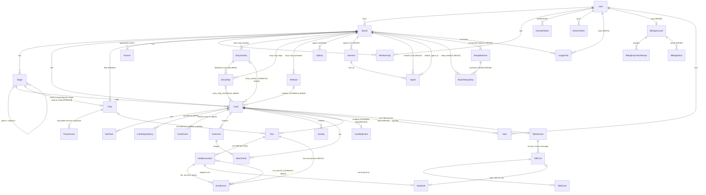

# Domain model

Every context is a `Boundary` sub-boundary declared in `lib/hamaca.ex` and listed in
`Hamaca`'s `exports` — that list is the authoritative context inventory; this page annotates
it. Schemas live in the `Schemas` peer (ADR 0002) so web and domain share structs without
sharing behavior.

## Contexts

- **Brand** — the one source for the user-facing names (RE477): `name/0` (`"Hamaca"`) and
  `agent_name/0` (`"Hamaca AI"`). A leaf with no deps; every code-level use of either name calls it.
- **Boards** — boards and their stage tree (stages, sub-lanes, review gates, WIP limits;
  AI-enabled is derived — `Hamaca.Flows.ai_stage_ids/1`: a stage some flow works in); renaming a main stage cascades to its sub-lane names (`"<name>:Review"` /
  `"<name>:Done"`, one transaction in `update_stage/2` — RE385), the sub-lane vocabulary and
  order being `Schemas.Stage.sublane_types/0`. Stage/config semantics: [ADR 0003](../adr/0003-card-state-stage-type-validity.md).
  **Board templates (RE442):** `create_board/2` takes an optional `template` slug from
  `Hamaca.Boards.Templates` (the ONE slug list, `slugs/0`), which loads
  `docs/designs/templates/*.json` at compile time via `@external_resource`; the web layer reads
  them only through `Boards.templates/0`. Without a slug the board gets today's default 8-stage
  pipeline and spec/plan/code flows; an unknown slug is `{:error, :unknown_template}` and
  inserts nothing. A template seeds, in one transaction, its main stages (with WIP limits),
  their sub-lanes, the releases, the seeded agents plus its own, its flows — disabled, every
  node an inline prompt with no `agent` and no `llm` (so it runs on the board default — except
  Three-brain's `claude_plan` / `gpt_plan` / `gemini_plan`, RE443) — and Review's `reject_to` =
  Plan; never cards. The template path also starts the board's setup checklist
  (`Hamaca.Setup.start/2`, same transaction); the default path does not.
  The reverse direction: `Boards.template_parts/1` renders a live board's main stages (with
  sub-lane types) and its flows (`Flows.Document`, minus `version` / `enabled` and every node's
  `llm`, in trigger-stage order) as a template file's `"stages"` / `"flows"`; a board created
  from a template whose nodes name no agent round-trips to its file. `prod pull-demo-flows` reads Pantry's and Streaks' through
  `Hamaca.Release.example_template_parts/1` (`bin/hamaca rpc`) and writes them into
  `design-led.json` / `bare-minimum.json` with `bin/pull_demo_flows.py`, keeping the picker
  copy, the template's agents and the files' hand formatting; it never touches the example-board
  JSON or cards.
  **Bare minimum**: Backlog · Plan (+Done) · Implement · Review · Deploy · Done, flows `plan`
  and `implement`. **Design-led**: Backlog · Next up · Design (+Review, +Done) · Plan (+Review,
  +Done) · Code · Review · Deploy · Done, flows `design`, `plan` and `code`. **Three-brain**:
  Backlog · Plan (+Review, +Done) · Implement · Review · Deploy · Done, flows
  `three-brain-plan` (a `fan_out` to Claude / GPT / Gemini planners, joined by a judge) and
  `implement`, plus the agents "GPT" (`codex`) and "Gemini" (`gemini-cli`) on each harness's
  first seeded model. Deploy never has a flow. A stage value outside `Schemas.Stage`'s sets
  fails the build; a template flow that fails validation raises and rolls the board back.
  **Board copy (RE447):** `create_board/2` also takes `copy_from` (a board slug), which wins
  over `template`. The source resolves through the membership-scoped `get_board/2` (a member
  board, archived or not); anything else is `{:error, :not_found}` and inserts nothing. In the
  same one transaction it copies the source's main stages, sub-lanes (inserted directly, so
  they keep their own names and WIP limits), positions and reject-to wiring remapped to the new
  stage ids; seeds the default releases; copies harnesses, agents and the default agent
  (`Hamaca.Agents.copy_from!/2`, before `ensure_seeded!/1`, which then only adds missing seed
  harnesses); and copies the flows onto the remapped stages, **disabled** at v1
  (`Flows.copy_board_flows!/3`). It is a plain copy: no cards, no public intake, no example
  template and no link back, so later edits to the source never reach it. The `.claude/` files
  the flows name are not copied — they live in the source's repo. It starts the setup
  checklist like a template board, step 1 reading `copied from <source name>`
  (`Setup.start/2`'s `:evidence` override; `Setup` may not call `Flows`, so the label is passed
  in). `copy_sources/1` lists what "New board" can copy from — `list_boards/1`'s boards, each
  with its main-stage and flow counts and `Flows.referenced_files/1` of its flows.
  **Board name + card key (RE455):** `create_board/2` takes the card key from `key` when given,
  else derives it from the name via `Schemas.Board.key_from_name/1` (the first two A–Z letters,
  upper-cased) with an "RL" fallback when that yields fewer than two; the slug still derives
  from the name. `Schemas.Board` owns the rules once — `key_from_name/1`, `key_format/0`
  (`[A-Z]{2}`) and `name_max_length/0` (80) — and its changeset stays the authority; a rejected
  name or key is `{:error, changeset}`, inserting nothing. The New board picker
  (`HamacaWeb.BoardsLive`) requires a name and a complete key for every option, templates and
  copy alike: the key follows the name (no fallback) until the user edits it, the
  `CardKeyInput` hook filters it while typing, both are passed through to `create_board/2`, and
  a changeset error keeps the picker open with the message under its field.
  `validate_new_board/2` (RE472) answers what `create_board/2` would for the same attrs without
  inserting — same resolution order (copy source → `:not_found`, template → `:unknown_template`,
  then the one shared new-board changeset → `{:error, changeset}` with action `:insert`), else
  `:ok`. `get_created_board/3` is the newest board a user owns (archived or not) with exactly
  that name and key inserted at or after a given time, so a replayed Checkout return finds the
  board it already created instead of creating a second.
  Stage structure (RE384): `create_stage/2` takes a category atom (Settings "+ Add") or an
  attrs map whose optional `before:` / `after:` anchor (a main stage on the board) places the
  new stage beside it and adopts its category; `place_stage/2` moves a main stage before/after
  an anchor the same way (`reorder_stage/2` stays the ↑/↓ step). `delete_stage/2` refuses, in
  order: the last main stage (`:last_stage`), any **live** card in the stage or its substages
  (`{:not_empty, %{live: n}}`), and the public intake stage (`:public_intake`). Archived cards
  never block (RE453): once every refusal has passed, they are **re-homed** in the same
  transaction as the delete (before it — `cards.stage_id` cascades) to the nearest surviving
  main stage before the deleted one in board order (the one after it when it is first), staying
  archived, snapped by `Schemas.Stage.arrival_status/2`, appended after the target's highest
  card position, each with one `:moved` activity (the `Hamaca.Cards` meta keys) attributed to the
  optional `actor` (default `:agent`) and logged with `Activity.log/3`'s `broadcast: false` — the
  one `{:stages_changed, board_id}` after the commit is the only announcement (hence `Boards`'s
  boundary dep on `Hamaca.Activity`). A flow never blocks a delete (RE429): the stage's flow goes with it
  (`flows.stage_id on_delete: :delete_all`; its runs keep `flow_key`, `flow_id` is nilified),
  and a reject-to target is nilified by the FK. `disable_lane/3` refuses the same for the lane
  alone (bare `:not_empty`, live cards only) and re-homes the lane's archived cards to its parent
  the same way. Changing a flow-holding stage to a non-work type
  (`Hamaca.Cards.update_stage/2`) is `{:holds_flow, %{stage:, flow:}}`; a substage passed to `delete_stage/2` / `place_stage/2` / `enable_lane/2` is
  `:not_a_main_stage`. `stage_refusal_message/1` is the one rendering of every refusal (Settings
  flash and API alike). A stage's **type** changes only through `Hamaca.Cards.update_stage/2`,
  which wraps `update_stage/2` and re-snaps resident cards when the type changed (it lives in
  Cards because `Boards → Cards` would be a boundary cycle).
  Over REST (`HamacaWeb.Api.StageController`, any board key): `GET|POST /api/stages`,
  `PATCH|DELETE /api/stages/:id`, `POST /api/stages/:id/place`, and
  `PUT|DELETE /api/stages/:id/substages/:lane`; the refusals map to 409 (`last_stage`,
  `not_empty` with the `live` count, `holds_flow` with `flow`, `public_intake`)
  and 422 (`invalid_anchor`, `not_a_main_stage`), each with `stage_refusal_message/1`'s sentence.
  The stage JSON's `ai_enabled` key is read-only, derived from `Flows.ai_stage_ids/1` (RE409);
  a create/update body naming `ai_enabled` (any value) is 422 `invalid_request` and writes nothing.
  Every `/api/stages` response also carries a read-only `problem` (RE430): the
  `Flows.Shape.wire/1` problem of the stage's flow when that flow is **enabled** and paused by a
  broken board shape (`Flows.shape_problems/1`), `null` otherwise. `CardJSON.stage/3` — the
  card and board responses — does not carry it.
  Also holds the RLY-69 public-board settings (`public_enabled` + `public_intake_stage_id`,
  written via `update_public_settings/2`) and `list_public_cards/1`, the public roadmap's
  card query (non-archived, stage category in `Stage.public_categories/0`).
  **Example boards (RE444):** `boards.example_template` (nullable, unique) marks a board as the
  public example of one template slug. It is written only by `mark_example/2` (via
  `Board.example_changeset/2`, never cast by `changeset/2`), which refuses a slug outside
  `Templates.slugs/0` (`{:error, :unknown_template}`) and one another board already holds
  (`{:error, changeset}`). `get_example_board/1` (`{:ok, board}` with stages in hierarchical
  order, or `:error`) and `example_boards/0` (`%{slug => board name}`, marked boards only) are
  unscoped reads, like `get_public_board/1`.
  `list_all_boards_for_admin/0` (every board, archived included, with owner email and
  member/card counts in one query, A–Z by name with no stars) and `member_board_ids/1` back the
  superadmin-only `/admin/boards` page (RE353). They are unscoped reads, and the gate is the
  `/admin` route.
  **Personal board stars** (RE395) live on the membership (`board_members.starred`, never cast
  by `Membership.changeset/2`), so a star is one flag per user per board and goes with the
  membership. `set_starred/3` sets (not toggles) the caller's own row by slug — archived boards
  allowed, `{:error, :not_found}` without a resolved membership. `list_boards_for_display/1`
  returns the user's non-archived boards as `%{board, starred?, muted?}` in **display order** —
  starred first, then case-insensitive name, `id` tiebreak — defined once in a private
  `order_by_name/1` helper (the admin list reuses its name half). `list_boards/1` deliberately
  stays creation-ordered (`inserted_at, id`): the board `/board` redirects to (the first one;
  with none it sends the user to the `/boards` first-run picker, RE470), `Cards.needs_you_feed/1`,
  `Cards.resolve_ref/3` and `AllController.resolve_board/2` depend on it, so starring never
  changes which board `/board` opens.
  The **per-board push mute** (RE406) lives beside it (`board_members.muted`, also never cast):
  one flag per member per board, written only by `set_muted/3`, which mirrors `set_starred/3`
  (sets, never toggles; only the caller's own row; `{:error, :not_found}` without a resolved
  membership). A muted member gets no alert push for that board, and the board's cards are left
  out of the app-icon badge (`Cards.needs_you_badge_count/1`, RE496); browser notifications and
  the in-app needs-you counts (feed, tab badge, switcher) are unaffected. Muting never moves a row
  in the display order.
- **Examples** (`Hamaca.Examples`, RE444) — the public, read-only example board for each
  template: **Streaks (bare-minimum)** `ST`, **Pantry (design-led)** `PA` and **Tiny Dungeon
  (three-brain)** `DU`. Content lives in `docs/designs/templates/examples/<slug>.json` (name,
  key, pitch, baton and facts lines, WIP How/Why/Here, per-stage `full`/`why` notes, per-flow
  blurb + selected node, and the cards top to bottom), loaded at compile time via
  `@external_resource` and checked against `Boards.templates/0`: an unknown stage or sub-lane, a
  status `Schemas.Stage.valid_status?/2` refuses, a question on the wrong card, a duplicate ref,
  a `full` note whose stage doesn't hold exactly its WIP limit, or an unknown flow / node key
  fails the build. `note_kinds/0` and `batons/0` are the closed sets; `all/0` / `get/1` read the
  content. `seed!/2` creates each missing board (one transaction per board) with
  `Boards.create_board/2` + `mark_example/2`, then the cards through `Hamaca.Cards` with their
  mockup ref numbers (by setting `card_seq`); it skips existing boards, and `reset: true`
  deletes and recreates them. The template's flows stay **disabled**, so no runner pulls a
  sample card. Entry points: `mix hamaca.examples.seed --owner <email> [--reset]`, and
  `Hamaca.Release.seed_examples/2` on the live node (`bin/hamaca rpc`). Its own boundary because
  `Cards` already depends on `Boards`. **Web:** the public route `/examples/:template` →
  `HamacaWeb.ExampleBoardLive`, in the router's `:public` `live_session` (beside
  `/board/:slug/public`), so it renders signed out (`current_scope` nil). It needs both
  `Boards.get_example_board/1` and `Examples.get/1`, else it raises `Ecto.NoResultsError` (a
  404 for an unknown or unseeded slug). It is static (no PubSub), renders the main stages
  through read-only `stage_column/1`s with every card's `sub_tasks` blanked (no run-derived
  progress), and handles only `select_card` / `close_card` / `select_node` — a final catch-all
  `handle_event/3` swallows every mutating event. Its "Use the <slug> template" button goes to
  `/boards?template=<slug>` when signed in, else through `/auth/google?return_to=…` to the same
  place. The New board picker (`TemplatePickerComponents.template_picker/1`'s `examples`, fed
  `Boards.example_boards/0` by `BoardsLive`) links each template card with a seeded example to
  `/examples/<slug>` in a new window.
- **Agents** — a board's LLMs (RE433). **Harnesses** (`Schemas.Harness`, table `harnesses`):
  an agent CLI's command template (`{placeholder}`s from `Schemas.Harness.placeholders/0`,
  optional `[ … ]` segments), optional `resume_command` / `session_id_path` /
  `signed_in_check`, and its closed `models` list; `key` is derived from the name once and never
  changes. **Agents** (`Schemas.Agent`, table `agents`): a unique name, a harness and one of its
  models. `boards.default_agent_id` (nilify on delete) is the agent a node with no `llm`
  inherits. `ensure_seeded!/1` (idempotent; called by `Boards.create_board/2`,
  `Flows.seed_default_flows!/1`, `seeds.exs`) gives a board the `seed_harnesses/0` (Claude Code,
  Codex, Gemini CLI) and, when it has no agents, "Claude Opus" / "Claude Sonnet" / "Claude Haiku"
  on `claude-code` with Opus the default; the `CreateHarnessesAndAgents` migration seeded every
  existing board from a frozen copy. `red?/1` (the agent's model has left its harness's list) is
  the one red-agent rule. A harness edit may drop a model in use (the agent turns red);
  `delete_harness/1` refuses while agents use it, `delete_agent/1` refuses the default and an agent
  a node names (`node_usage/1`). Renaming an agent rewrites `llm` on the board's flow nodes
  without bumping their version. At run time `resolve/2` turns a node's `llm` into its agent
  (`{:ok, _}` / `{:red, _}` / `{:error, {:unknown_agent, name}}`) for `Hamaca.Runs.build_payload/4`,
  and `harness_wire/1` + `harnesses_digest/1` are the runner's view of the definitions —
  including each harness's embedded usage rule (`Schemas.HarnessUsage`, RE436, evaluated by
  `Schemas.HarnessUsage.Rule`), seeded per harness in `seed_harnesses/0`
  (`node_jobs.harness_key`, `runners.harnesses` and the claim filter are in
  [runner.md](runner.md) "Harness routing"). Depends on `Repo` + `Schemas` only — it reads/writes
  `Schemas.Flow` rows directly, because `Hamaca.Flows` depends on it. Humans edit both lists in
  Board Settings → **Agents** (`?section=agents`, `HamacaWeb.AgentsSettingsComponents` rendered by
  `BoardSettingsLive`, which formats the structured delete refusals into copy).
- **Flows** — workflow definitions as declarative graph data ([ADR 0006](../adr/0006-workflow-orchestration.md)): per-board
  rows in the `flows` table (`key`, `enabled`, `isolation`, `version`, and the one stage the flow
  works in, `stage_id`) with the node/edge graph embedded as jsonb.
  **One stage (RE429):** a flow belongs to exactly one **main** stage of a work type
  (`Schemas.Stage.work_types/0`) — `stage_id` is `NOT NULL`, unique (`flows_stage_id_index`:
  a stage holds zero or one flows, disabled ones included) and `on_delete: :delete_all`
  (deleting a stage deletes its flow; `runs.flow_id` is nilified, `runs.flow_key` kept).
  Where it **pulls from** (pickup) and **lands on** (drop-off) are never stored: they are worked
  out from board order (`Schemas.Stage.order_stages/1`) by `Schemas.Stage.neighbours/2` (via `Hamaca.Flows.neighbours/2`) — the
  stage immediately before it, and the stage immediately after it (its own first substage when it
  has one, else the next main stage), `nil` at either end. `neighbours/1` is the DB convenience
  the engine asks at the moment it needs the answer (drop-off is resolved when the run lands);
  `list_flows/1` / `get_flow_with_stages/2` fill the virtual `pulls_from_stage` /
  `lands_on_stage` fields on every read.
  **Node LLM (RE433):** an agent node's `llm` names one of the board's agents (`Hamaca.Agents`),
  nil = the board default. `create_flow/2`, `update_flow/2`, `upsert_from_document/3` and
  `seed_default_flows!/1` refuse a name that is not an agent on the board
  (`node "<key>" names LLM "<name>", which is not an agent on this board`). The pre-RE433 node
  `model` is a legacy alias (`Schemas.Flow.Node.legacy_models/0`, `"opus"` → `"Claude Opus"`)
  renamed by `normalize_legacy/1`; the `RenameNodeModelToLlm` migration rewrote stored `flows` and
  `flow_versions`, raising on an unknown model.
  **The shape rule (RE430):** `Hamaca.Flows.Shape` is the ONE owner of whether a flow's board
  shape can work and of every word explaining a broken one. `Shape.problems/2` (pure, over the
  ordered stages and every flow, enabled or not) built on `neighbours/2` gives a broken flow
  exactly one problem, of the first kind in `Shape.kinds/0` that applies — `:no_upstream`
  (nothing before its stage), `:upstream_review` (a Review column right before it),
  `:upstream_working` (a work/planning column right before it, naming that stage's flow when it
  has one), `:no_downstream` (nothing after it) — carrying `what` / `why` / `fixes` (actions from
  `Shape.fix_actions/0`) / `columns` (the stage two either side, marked `:self` / `:offending`).
  `Shape.wire/1` is its one JSON projection and `Shape.paused_detail/1` the "paused" sentence;
  consumers render the wording verbatim. Nothing is stored: `shape_problems/1` is the DB
  convenience, and `list_flows/1` / `get_flow_with_stages/2` fill a virtual `problem` field
  (`nil` when healthy; computed against all the board's flows, no extra query on the list
  path). A flow with a `problem` is never `Hamaca.Runs.queued_flow/5`'s queued flow, and
  `Hamaca.Runs.Preflight` reports it as `stages: {:problem, problem}` (the enable-preflight row
  shows its `what`). `Hamaca.Flows.paused?/1` is the ONE "paused" predicate (enabled **and** a
  non-nil `problem`) every consumer calls, and `Hamaca.Boards.apply_shape_fix/2` executes one of a
  problem's structured fixes through the existing stage paths (so it broadcasts
  `{:stages_changed, board_id}`). Two web surfaces render `Hamaca.Flows.Shape` problems verbatim
  (RE432): the Board Settings › Stages **shape callout**
  (`HamacaWeb.FlowShapeComponents.shape_callout/1` — WHAT / WHY / BOARD ORDER / one-click FIX,
  event `apply_shape_fix`) and the board's **paused-flow banners**
  (`HamacaWeb.FlowShapeComponents.paused_flow_banners/1` — one per paused flow, collapsing into
  one summary banner at 3+, **Fix in Stages →** on non-archived boards) plus the "AI paused"
  column chip (`stage_column/1`'s `paused`); both refresh on `{:stages_changed, board_id}`.
  `Schemas.Stage.lane_word/1` is the one sub-lane word (`"Code · Done"`),
  shared with `Hamaca.Boards`. `stage_flow/1` is the stage's flow (or nil),
  `assignable_stages/2` the stages a flow may be put on, `copy_flow/2` copies a definition onto
  another empty stage (disabled, v1).
  `"start"`/ `"start"`/
  `"done"`/`"needs_input"` are edge sentinels (`"needs_input"` is `to`-only and parks the run —
  RLY-194); nodes carry an optional `timeout_minutes` (validated `> 0`) and an agent-only
  `expects_commits` boolean (default `false`, RLY-194) marking a node whose reported success
  `RunServer` may override if it produced no commits.
  Every node also carries a `reads`/`writes` **card-field contract** (RE244; vocabulary
  `Schemas.Card.contract_fields/0`) — `writes` is enforced at run time by
  `RunServer.override_missing_writes/4`, `reads` is advisory.
  Every node may also carry an optional **`role`** (`:do | :check | :fix`, RE346; vocabulary
  `Schemas.Flow.Node.roles/0`) — **display-only**, never read by the engine or the runner.
  `Schemas.Flow.node_roles/1` resolves every node's role, first match wins: the authored `role`;
  else `:fix` when every inbound edge is `on: :failed` (the `"start"` edge counts and is never
  failed); else `:check` for a `:gate`; else `:do`. The default Code flow authors `role: :check`
  only on the six checks the guess can't see (`spec_review`, `quality_review`, `final_review`,
  `smoke`, `acceptance`, `deploy`).
  The invariant that no `:agent`/`:gate`
  node in any shipped flow leaves `:failed` unrouted is enforced by
  `default_library_test.exs`.
  `Hamaca.Flows.seed_default_flows!/1` idempotently seeds the default spec/plan/code library
  (from `Hamaca.Flows.DefaultLibrary`, which **loads** `docs/designs/flows/*.json` at
  compile time via `@external_resource` — those files are the source of truth, and
  `Hamaca.Flows.Document` is the one serializer both they and the API go through)
  — `Boards.create_board/2` calls it after enabling the `Spec:Review`/`Spec:Done`/`Plan:Done`
  sub-lanes so every trigger resolves. Flows seed disabled. Nothing executes yet — the engine is the Runs card (02).
  A template board's flows go through `Hamaca.Flows.seed_template_flows!/2` instead (RE442):
  the same trigger-name resolution, changeset, one-stage rule, LLM check and v1 snapshot, but it
  **never skips** — an unknown trigger stage raises `ArgumentError` and an invalid flow raises
  `Ecto.InvalidChangesetError`, atomically.
  **Versioning (RLY-152, absorbed into the flow editor card):** every flow's definition
  (nodes, edges, isolation) is versioned — `flows.version` holds the current number, and each
  version is snapshotted immutably into `flow_versions` (`belongs_to :flow`, `version`,
  `isolation`, embedded `nodes`/`edges`; no `updated_at`, never edited after insert). A flow
  always has a snapshot row for its current version — created on `create_flow/2`,
  `copy_flow/2`, `seed_default_flows!/1` and `seed_template_flows!/2`, and on every bump — the invariant a future
  Runs pin-to-version feature relies on. `save_definition/2` is the one path that changes a
  flow's definition after creation: it validates like `update_flow/2`, then bumps `version` to
  n+1 and writes a new snapshot **only if** the definition changed; a stage-only change
  (including a stage rename) saves with no bump, since the stage is per-board wiring and not
  part of the versioned definition. `get_version/2` fetches an immutable snapshot by number;
  `mid_run_count/1` returns the real count of cards currently mid-run on a flow — runs whose
  status is active (`Schemas.Run.active_statuses/0`, i.e. running or parked) — and feeds both
  the flow-editor save note and the delete-confirm warning, so that number is defined once.
  **Serialization (RLY-241):** `Hamaca.Flows.Document` is the one serializer for a flow's canonical
  JSON document — `encode/1` (sparse: nil and schema-default fields omitted) and `decode/1`
  (dense: every node/edge field present, filled from the schema default, so `customized?/1`'s
  field-by-field comparison against the embedded structs stays exact). `decode ∘ encode` is a
  fixed point, which is what makes pull → push unchanged a no-op. The trigger serializes as
  one stage **name**, `{"stage": "<name>"}`, not an id, so a document is portable across boards;
  a legacy three-key trigger (`pulls_from` / `works_in` / `lands_on`) still decodes, reading only
  `works_in`. `Document.derived/1` is the read-only `{"pulls_from", "lands_on"}` name pair the
  API puts beside the document (`GET /api/flows[/:key]` and the `PUT` response:
  `"derived"`); `encode/1` never emits it and `decode/1` accepts and ignores it — and likewise a
  read-only `"problem"` key (RE430) — so a pulled file pushes back unchanged.
  `upsert_from_document/3` is the write path behind `PUT /api/flows/:key`: decode → key check →
  resolve the trigger's stage name → optional compare-and-swap on `version` → refuse a stage
  another key already holds (`{:stage_occupied, %{stage:, flow:}}`, API **422
  `stage_occupied`**, sentence from `stage_occupied_message/1`) → `create_flow/2` or
  `save_definition/2` → reconcile `enabled` through `enable_flow/1`/`disable_flow/1`, all in one
  transaction so a push never half-applies.
  Flows are managed from **Board Settings › Stages** (RE431 — the RLY-142 Flows tab is gone;
  `?section=flows` lands on Stages): each main-stage row owns its flow through a FLOW band
  (`HamacaWeb.FlowSettingsComponents.flow_band/1` — chip, `v<n> · <m> nodes`, a direct On/Off
  toggle, a ⋯ menu) and a read-only PULLS FROM → WORKS IN → LANDS ON row worked out by
  `neighbours/2`. A paused row (RE432) carries the shape callout for its problem; the board
  links each paused flow's banner here, anchored on `#stage-<id>-row`. The band is backed by `customized?/1`
  (normalized nodes/edges/isolation comparison against the library — stage wiring never
  counts), `default_key?/1`, `copy_flow/2` (a disabled `<key>-<stage>` copy on another empty
  stage — the band's **Copy to another stage…**, which replaces the old Duplicate; its picker
  lists only `assignable_stages(board, nil)` and previews the key with `copy_key/2`, which
  `copy_flow/2` itself calls so the preview and the copy never disagree), `unique_key/2`
  (the `base`/`base-2`/… generator behind copy keys), and — replacing the tab's "+ New flow"
  create-from-scratch panel (RLY-158), which is gone — the no-flow band's **+ Add flow**, backed
  by `addable_defaults/1` (the library keys, in library order, not yet on the board) and
  `add_flow/2` (`{:default, key}` seeds that library definition, `:blank` a bare `start → done`
  graph keyed by the stage slug or `flow`; either way a disabled v1 flow with its snapshot,
  validated by the same one-stage rule as `create_flow/2`), and
  `reset_to_default/1` (restores the shipped definition via `save_definition/2`, so a reset
  bumps the version and snapshots like any other save; stage and `enabled` untouched), and
  `delete_flow/1` (RLY-221 — removes a flow from this board, disable-first: an enabled flow
  returns `{:error, :flow_enabled}`, a disabled one is deleted and the DB cascade nil-s each
  active run's `flow_id` (`runs.flow_id on_delete: :nilify_all`) and removes its version
  snapshots (`flow_versions.flow_id on_delete: :delete_all`); a deleted shipped default does
  not re-seed on the next deploy).
  `diff_from_default/1` structurally diffs a customized default flow against its shipped
  default (`nil` for a non-library key) — nodes grouped added/removed/changed (changed lists
  the differing fields), edges as `{from, to, on}` tuples grouped added/removed.
  **Editor (RLY-143):** `HamacaWeb.FlowEditorLive`, a full-page LiveView at
  `/board/:slug/flows/:key`, edits a flow's working copy (nodes/edges/isolation/stage) with
  inline validation against `Schemas.Flow.changeset/2`, saves through `save_definition/2`
  behind a "Save as v(n+1)" confirm modal, and offers the diff-vs-default / reset-to-default
  affordance for customized library flows. The graph is rendered by the shared
  `HamacaWeb.FlowGraphComponents.flow_graph/1` function component (absolutely-positioned node
  divs + an SVG edge layer, `interactive?` toggles `phx-click`, accepts `node_states` for a
  later read-only reuse by the run panel) laid out by the pure, unit-tested
  `HamacaWeb.FlowLayout.layout/2` (a deterministic layered layout — a thin adapter over the
  vendored `dagre_ex` (`Dagre`) that sizes nodes and edge labels, ranks them top to bottom and
  returns axis-aligned edge polylines with a reserved label point per edge; the succeeded spine (`FlowLayout.spine/1`, start → … → done) is edge-weighted so it lays out as one vertical line; no stored
  coordinates, no dragging). FlowLayout then spreads edge endpoints into per-edge ports along
  each node's top/bottom border, ordered so lines don't cross at the node (RE340); a spine edge keeps the node's centre port on non-gate nodes so it stays straight. Hovering a
  node emphasises its incident edges client-side via the
  `FlowFocus` hook (`assets/js/hooks/flow_focus.js`, reading the graph's `data-adjacency`); a
  selected node gets the same emphasis server-side (RE333).
  A work node's main field (agent RUN PROMPT, shell COMMAND, gate CONDITION) shows in the
  inspector as a rendered, clamped preview (`Hamaca.Markdown.to_prompt_html/2`, `{placeholder}`
  chips, the `PromptClamp` hook's fade) whose Expand opens `FlowEditorComponents.prompt_sheet/1`,
  a full-height right-edge Read/Edit sheet over the selected node (`@prompt_sheet`, Edit posting
  the same `edit_node_field`) (RE459). On an archived board the editor graph stays selectable
  (`interactive?` is always on) so the read-only inspector and Expand-to-read are reachable, while
  every mutating event — and the sheet's Edit mode — is refused with the read-only flash.
  **Requirements (RLY-182):** `Flows.node_requirements/1` is a pure graph read — the agent
  and skill names a flow's nodes name, with no runner knowledge. It lives here rather than
  in Runs because `Flows` may not depend on `Runs` (a boundary cycle the compiler rejects);
  `Runs` reads it to answer whether anyone can actually satisfy it.
  **Referenced files (RE447):** `Flows.referenced_files/1` is the same pure read over one flow
  or a list, shaped as repo files: one `%{kind: :agent | :skill, name, paths, used_by}` per
  distinct agent or skill, in first-appearance order, `used_by` being every
  `%{flow:, node:}` naming it. An agent's path is `.claude/agents/<name>.md`; a skill is
  present at either `.claude/skills/<name>/SKILL.md` or `.claude/commands/<name>.md`. It
  shares `node_requirements/1`'s extraction (a skill only from an agent node's leading slash
  command) and is the ONE place those path shapes live: the template picker's copy warning
  (via `Boards.copy_sources/1`) and `GET /api/setup` both read it.
- **Runs** — the workflow execution engine ([ADR 0006](../adr/0006-workflow-orchestration.md)): a run executes a
  `Schemas.Flow` graph against a card as a supervised, Postgres-backed state machine. This
  boundary owns five things.
  **The engine** (`Hamaca.Runs.Engine` / `RunServer`): outcome routing, per-node `max_retries`,
  per-edge `max_loops`, the visit cap, the failure-signature breaker (whole-run), needs-input
  parking and restart resume — budgets are per-`foreach`-iteration and per fan-out branch
  ([runner.md](runner.md#fan-out-regions-re437)).
  **The scheduler brain**: `Hamaca.Runs.Scheduler.plan/1`, a pure `Snapshot → Plan` behind a
  per-board `Scheduler.Server`; `capacity_diagnosis/1` turns an empty/silent roster into a verdict.
  **The read side**: `list_runs_for_card/1`, `latest_run/1`, `run_summaries_for_board/1`,
  `run_summary_for_card/1`, `happy_path/1`, `queued_flow/5`, `face_summary/5` — one shared
  private builder, so the summary shape is defined exactly once; a summary carries `branches` (the open region entry's tally and per-branch bars, nil when no region is open — one batched query per board, RE440). `RunDetail` groups each fan-out region entry into one `:region` timeline row with a lane per branch, and exposes the branch partition once as `branch_bar/1`, `branch_tally/1` and `bar_states/0` (RE440; see [runtime.md](runtime.md#fan-out-regions-re437)). `list_runs_for_card/1` join-preloads each run's `flow: :stage` in the runs query (no per-run N+1), so `RunDetail` carries `stage_name` — the run's work stage's name, nil when the flow or its work stage is gone (RE426). Flow metrics read each execution's work / rework / rewind class from ONE function, `execution_spans_for_flow/2` (RE348; see [runner.md](runner.md)). The four metrics roll-ups (`node_metrics_for_flow/2`, `node_waits_for_flow/2`, `execution_spans_for_flow/2`, `flow_metrics_summary/2`) take `card_id:` (one card, RE235) or `card_ids:` (a list — RE349's Last-N population, `card_id:` winning when both are given); either drops the window. `first_node_queue_wait/2` (RE349) is the mean `claimed_at − inserted_at` of the `NodeJob.flow_kinds/0` job bound to each in-population run's first execution — the value stream's queue triangle.
  **The board-health audit** (RE249): `Hamaca.Runs.audit/2` / `Hamaca.Runs.Audit.findings/2`, a pure function over runs (`:node_executions` and `card: :board` preloaded) on the metrics' `metric_windows/0` vocabulary, answering *is this board's history clean?*; owns `severities/0`/`checks/0`, advisory. Four checks — `findings_dropped`, `verdict_flipped`, `planner_not_migrated` (RE368), reading the `runs.tasks_from_plan` fact `start_run` sets when the legacy plan-parse fallback seeded the card's tasks, and `outcomeless_attempts` (RE410), one WARNING per `{run, node, visit}` with at least `Hamaca.Runs.max_outcomeless_reentries/0` outcome-nil executions.
  **Steer now** (RE358): `steer/4`, `steer_state/1`, `steer_receipts/1`; the server-only `:steered` outcome (`NodeExecution.server_only_outcomes/0`) — see [runner.md](runner.md#steer-now-re358).
  **The dispatcher seam**: the `Hamaca.Runs.Dispatcher` behaviour, resolved through `Hamaca.Runs.Instance` (`config :hamaca, :runs_dispatcher` in production, a per-test instance under test — RE298 / ADR 0009).
  Card writes go through `Hamaca.Cards`, so ADR 0003/0004 rules apply automatically.
  Run/node/job statuses are in [state.md](state.md); dispatch, the runner, worktrees and the
  transport in [runner.md](runner.md); the failure grid in [failures.md](failures.md). Why:
  [ADR 0006](../adr/0006-workflow-orchestration.md), [ADR 0007](../adr/0007-card-lifecycle-and-failure-states.md); per-function detail in the `Hamaca.Runs` `@moduledoc`.
- **Cards** — the card lifecycle: create/edit/move/archive, status (`working`,
  `needs_input`, `failed`, …), sub-tasks, spec/plan/branch/pr fields, approve/reject
  (after a decision, `next_awaiting_review/4` names the next card in the lane awaiting review —
  `Schemas.Card.awaiting_review?/1` — in `stage_column/2` order, wrapping, for the review drawer
  to advance to, RE388), needs-input questions. `answer_input/4` (`image_notes:
  [{question_number, image_ids}]`) and `reject/4` (`image_ids:`) post each non-empty image
  list as an image-only note tagged with its origin (`{:answer, n}` / `:rejection`) *before*
  the answer / changes-requested comment, all in one `Repo.transaction` — a failed answer or
  reject (or a bad image id) leaves no note behind; empty opts behave exactly as `/3` (RE428).
  `failed` (RLY-179) is set only by `Hamaca.Cards.mark_failed/3` when a
  run ends terminally — a separate path from `needs_input`'s genuine question.
  **Tasks** (RE355) are addressable `sub_tasks` rows with a nullable markdown `body`:
  `list_tasks/1`, `get_task/2`, `add_tasks/2`, `update_task/3` and `delete_task/2` write one row
  at a time. `add_tasks/2` appends the batch atomically after the current last task, in argument
  order; `delete_task/2` decrements every later row's `position` so positions stay `0..n-1`; both
  take a `FOR UPDATE` lock on the card row first. No call rewrites another row's id, title, body
  or `done` (`done` stays `set_sub_task_done/3`'s). `set_sub_tasks/2` remains the legacy
  full-replace path (`PATCH /api/cards/:ref` with `sub_tasks`): it deletes and re-inserts every
  row, nilifying each `node_executions.sub_task_id` bound to them — never use it for a per-task
  edit. Card state × stage validity is governed by
  [ADR 0003](../adr/0003-card-state-stage-type-validity.md); ownership and the claim rule
  by [ADR 0004](../adr/0004-card-ownership-and-the-claim-rule.md) — a user owner must hold a
  resolved membership on the card's board, checked in `Hamaca.Cards` via
  `Hamaca.Members.member_user_id?/2` on every owner write (`{:error, :owner_not_member}`, API
  **422 `owner_not_member`**), and a whole owner list (`set_owners/3`, and its `check_owners/2`
  pre-flight) may name the agent or people, never both (`{:error, :mixed_owners}`, API
  **422 `mixed_owners`**); derived agent health
  (`Cards.health/1`, 90s `STALE_AFTER`) and the four-bucket needs-you rollup
  (`needs_input` / `in_review` / `awaiting_human` / `agent_stalled` — RLY-148) surfaced by
  `GET /api/board` and the boards-home badges. A move that would strand a live run
  (`Cards.stranded_run/2`: an active run whose flow's `stage` is not the destination) is
  refused up front with `{:error, :would_strand_run}` — `POST /api/cards/:ref/move` maps it to
  **409 `would_strand_run`** (RLY-217); the board pre-checks and confirms instead of surfacing
  the raw error.
  A card's `mockups` (RE370) is a nullable `{:array, :map}` column of
  `%{"url", "caption"}` entries, written only through `Hamaca.Cards.set_mockups/2`: a full
  REPLACE, validated so every url is an `/attachments/<id>` path of an **HTML or image
  attachment on the same card** (`Schemas.Attachment.mockup_types/0`, RE390; `422
  invalid_mockups` over the API), broadcast as `{:card_upserted, card}`.
  `:mockups` is a flow contract field (`writes: ["mockups"]`), blank when nil/empty. It is
  distinct from `ai_result.screens` (run-result screenshots).
  The drawer renders mockups in a **Mockups** section above Description as a wrapping row of 80px
  square tiles (`CoreComponents.mockup_preview/1`, RE374): each tile is a live miniature (an inert
  `<iframe sandbox="allow-scripts">` rendered at 1280px and CSS-scaled down) with the caption as
  its tooltip and aria-label. Clicking a tile opens, **in the same tab**, `HamacaWeb.BoardLive`'s
  mockup viewer mode (RE380): the `mockup=<attachment id>` param on the card's drawer URL
  (`/board/:slug?card=<ref>&mockup=<id>`, `/board/:slug/story-map?card=…&mockup=…`, and
  `/cards/:ref?board=<slug>&mockup=<id>` in the native host). The viewer shows a 340px left sheet
  (the card's gate panel — review or question stepper — plus the Mockups tiles, the current one
  ringed) and the sandboxed frame under the breadcrumb top bar, whose card crumb names the card;
  on phones it is full screen under one bar with no review controls. Switching (a tile, ←/→,
  ‹ ›, a swipe) replaces the history entry, so one browser Back, Esc or "← Back to card" returns
  to the drawer; an invalid or stale `mockup` id falls back to the drawer.
  Embedded (the native host, RE393), an HTML mockup zooms from Fit to 400% (− · Fit · + over the
  frame) and its frame scrolls sideways once zoomed, in both phone and desktop render widths.
  The native card host's `nav` param (RE400, `HamacaWeb.NativeCardNav`) — comma-separated `prev` /
  `next`, e.g. `/cards/:ref?board=<slug>&nav=prev,next` — names the neighbors the native shell has:
  it drives the drawer's ‹ › chevrons in native mode, where each calls the shell's `relayCardNav`
  bridge (`"prev"` / `"next"`) instead of patching, binds no arrow keys, and renders disabled for a
  direction `nav` omits. No `nav` (or no known token), no chevrons; `nav` rides through the
  viewer's patches like `back`, and `/board/:slug` ignores it.
  Card mode never patches itself to the board (RE498): when the open card is archived — from its
  ⋯ menu or elsewhere — the server pushes `"native-back"` once with a message (`"<REF> archived"` /
  `"<REF> was archived"`), and the `.NativeBack` hook's hidden listener calls the shell's
  `relayNavBack` bridge with it (the app pops and toasts it; a plain browser `history.back()`s).
  The same viewer opens the AI Result's **Screenshots** (RE390): the drawer shows them as the same
  80px tiles, which lead the violet AI Result box with a count and are always visible (RE401 —
  Show more reveals only the Changes and is absent when there are none), and a tile patches to
  `screenshot=<n>` (1-based among the openable screenshots; an agent-local path is a placeholder
  tile, never a viewer item) on the same three hosts. BoardLive
  holds one `viewer` assign, `nil | %{section: :mockups | :screenshots | :images, key: _}`; the sheet shows
  only the section that was opened and ←/→ stay within it. `mockup` wins when both params are
  present; a malformed, out-of-range or stale `n` falls back to the drawer (a cold open waits for
  the async body fill, since the light card has no `ai_result`). Tiles and the viewer pick **HTML
  vs image** by content type (`Hamaca.Attachments.content_types/1` → `HamacaWeb.CardMedia`): only a
  same-card `/attachments/<id>` HTML attachment is framed; everything else is an image, shown in
  the viewer at its natural size in an `overflow-auto` frame. Markdown images in descriptions,
  specs and comments keep the RE322 `image_lightbox`.
  **Note images** (RE427) are the viewer's third section: each posted note renders its images
  under the body as a wrapping row of 108px-tall thumbnails (`CoreComponents.note_image_row/1`,
  outside the `.md` body so the lightbox never claims them; an image-only note has no body box),
  live in every open drawer via `:timeline_appended`. A thumbnail patches to `image=<attachment id>`
  on the same three hosts (`/board/:slug?card=<ref>&image=<id>`,
  `/board/:slug/story-map?card=<ref>&image=<id>`, `/cards/:ref?board=<slug>&image=<id>`), giving
  `%{section: :images, key: id}`. Its items are `HamacaWeb.CardMedia.note_image_items/1` over
  BoardLive's `@note_image_comments` (the notes with images, kept in lock-step with the
  `:conversation` stream by `stream_notes/2` / `insert_note/2`): every note image on the card,
  oldest note first, then upload order. The sheet reads `Images · N` with each filename under its
  tile and a `From a note by <author> · <time ago>` byline; the header counts `Image n of N`.
  Precedence is `mockup` > `screenshot` > `image`; a cold `?image=` waits for the async body fill
  (the conversation), then an unknown or malformed id, an unlinked upload, a mockup, or another
  card's note image falls back to the drawer.
  `/attachments/:id/view` (`HamacaWeb.MockupViewerLive`, `HamacaWeb.attachment_view_path/1`) is the
  legacy RE370 link: an authenticated, membership-scoped redirect to that viewer URL in the
  `:require_authenticated` live_session; it 404s for a non-member, an unknown id, or a non-HTML
  attachment. Hamaca's UI never links to a raw HTML attachment as a top-level page.
  Archive and restore (`Cards.archive_card/2` / `Cards.unarchive_card/2`) are reachable from the
  board-key API as `POST /api/cards/:ref/archive` and `POST /api/cards/:ref/unarchive` (RE318,
  `./hamaca archive` / `unarchive`), attributed to `:agent`. The API archive refuses a card with
  an active run (`Hamaca.Runs.active_run/1`) with **409 `active_run`** and writes nothing; that
  guard lives in `HamacaWeb.Api.CardController`, **not** in `Cards.archive_card/2`, so the board
  UI's Archive button stays unguarded as shipped. Instead of refusing, a board
  archive **cancels** the card's active run (RE335): `Hamaca.Runs.Listener` reacts to
  `{:card_archived, card}` and closes it `:cancelled` with `run cancelled — card archived`
  (the `RunnerReaper` sweep backstops it), which lets the runner release the card's held
  worktree on its next heartbeat. The drawer's confirm says so ("Its active run will be
  cancelled.") only when the card has an active run. Unarchiving never revives that run. Both
  are idempotent through the domain functions (a repeat logs nothing), and neither is on the
  `/api/all` user-token scope.
  The per-board summary — top-level `stage_count`, non-archived `card_count`, `ai_active?`,
  and both needs-you counts (`needs_you_count`, the web's three-type sum, and
  `needs_you_two_type`, the mobile count, ADR 0005), plus the user's personal `starred?`
  (RE395) and per-board push `muted?` (RE406) — is `Hamaca.Cards.list_board_summaries/1` (RE376), the one definition both the web
  boards home (`HamacaWeb.BoardsLive`) and the native board switcher read. Its rows come in
  `Boards.list_boards_for_display/1` order (starred first, then A–Z), so both surfaces agree
  on order and flag by construction. The app-icon badge, `Cards.needs_you_badge_count/1` (RE496),
  is the sum of `needs_you_two_type` over the user's **unmuted** rows (one per board, duplicate
  membership rows collapsed), so it always equals the switcher's amber pills. The switcher's list is **`GET /api/all/boards`** on the
  `/api/all` user-token scope (`AllController.boards`, `HamacaWeb.Api.BoardListJSON`), returning
  `{data: [{name, slug, key, needs_you_count, stage_count, card_count, ai_active, starred, muted}]}`
  in display order, with `needs_you_count` = the two-type count and `starred`/`muted` booleans.
  The switcher's star is **`POST /api/all/boards/:slug/star`** (RE396, `AllController.star`) —
  body `{starred: <bool>}`, which sets (never toggles) the caller's own star through
  `Boards.set_starred/3` and answers `{data: {slug, starred}}`; a repeat is a 200 no-op. A
  non-member or unknown slug is a 404 `not_found`; a missing or non-boolean `starred` is a 422
  `invalid_request` (validated before the membership lookup). The client never re-sorts — it
  re-reads `GET /api/all/boards` for the server's order.
  The switcher's mute is **`POST /api/all/boards/:slug/mute`** (RE406, `AllController.mute`) —
  body `{muted: <bool>}`, which sets (never toggles) the caller's own mute through
  `Boards.set_muted/3` and answers `{data: {slug, muted}}`; a repeat is a 200 no-op. A
  non-member or unknown slug is a 404 `not_found`; a missing or non-boolean `muted` is a 422
  `invalid_request` (validated before the membership lookup). Muting never re-sorts the list.
  Mute is native-only: the web boards home (`/boards`) has no mute control, though the mute is
  still enforced server-side.
  Card **search** is `Hamaca.Cards.search/3` (RE198) — the one definition of what matches a query:
  the exact ref (`RLY-12`, `rly-12`, or a bare `12`) ranked first, then whitespace-token-AND,
  case-insensitive `ILIKE` matches on `title` in board order, with `%`/`_` escaped so a wildcard
  query cannot return the board. Board-scoped (a ref can never resolve across boards, the same
  authorization check `get_card_by_ref/2` is), Done included, archived opt-in via `:archived`,
  capped by `:limit`, and carrying `list_cards/1`'s trimmed projection. Three surfaces call it and
  none re-implements it: `GET /api/cards?q=` (with `limit`/`archived`; **no `q` leaves that
  listing exactly as it was**), `./hamaca search`, and the board header's results popover.
- **Members** — board membership; who can see and act on a board. `member_user_id?/2` is the
  one membership query (also the card-owner rule `Hamaca.Cards` enforces).
- **Presence** (`Hamaca.Presence`) — who is looking at a board's **story map** right now, and
  where their pointer is (RE257); the app's first `Phoenix.Presence` context, supervised
  directly after `Phoenix.PubSub`. Two board-scoped topics it owns outright:
  `story_map_presence:<board_id>` (the roster, via Phoenix.Presence's diff protocol) and
  `story_map_cursor:<board_id>` (the ephemeral cursor stream). **Neither goes through
  `Hamaca.Events`** — that bumps the board version on every call, so a 20 Hz cursor would make
  the CLI refetch the whole board on every mouse twitch; `Hamaca.PresenceTest` pins the version
  as unchanged after a track, a cursor and a view write. Tracked by **user id**, so one person
  with three tabs is one avatar; tracking happens only for `live_action == :story_map`
  (the kanban board renders no presence UI), and untracking is the tracked pid's exit.
  Humans only — no AI/agent avatar and no agent cursor.
- **Accounts** — users, Google sign-in and Sign in with Apple. `GoogleTokenValidator` verifies
  native Google ID tokens; `AppleTokenValidator` verifies iOS Apple identity tokens locally
  against Apple's JWKS (RS256 pinned, then `iss`/`aud`/`exp`, a SHA-256 nonce bound to the raw
  nonce the app sends, and a verified email). They back the two native endpoints
  `POST /api/auth/native/google` and `POST /api/auth/native/apple`, which share one sign-in tail
  (same session cookie and `{success, user, token, feedback_url, billing}` body); `GET /api/auth/native/me`
  returns the same shape. `feedback_url` is `RELAY_FEEDBACK_URL` (`null` when unset or blank), read
  only via `HamacaWeb.Feedback` — the native Settings "Suggest an idea" row and the web account
  menu's "Suggest an idea" link both use it (RE397). `billing` (RE466) is
  `Hamaca.Billing.native_status/2`, beside `user` rather than inside it:
  `{"enabled": bool, "standing": "free"|"active"|"past_due"|"cancelled"|"comped"|"paused"|null,
  "through": "YYYY-MM-DD"|null}`. It feeds the native Settings ACCOUNT › Plan row (status only, no
  purchase UI; `free` reads "Free", RE469). `through` is `paid_through` while active or past due,
  `access_until` once cancelled, and `null` on Free, comped or paused. An app build older than
  RE469 doesn't know `"free"`, parses it to null and hides the Plan row — no server shim
  ([ADR 0013](../adr/0013-the-free-plan.md)). Billing disabled sends
  `{"enabled": false, "standing": null, "through": null}`. A 401/422/500 body has no `billing`. Every provider sign-in goes through `upsert_user_from_provider/2`, which looks the
  user up by `provider_uid` first, then by normalized verified email (signing in that existing
  user and keeping its `provider`/`provider_uid`), and inserts only when neither matches; a
  nil profile claim never overwrites a stored value. User API tokens for `/api/all` (the native feed, card actions, card create, the board list, and the board star and mute).
  `get_user_by_email/1` is a case-insensitive lookup (the example-board seeders, RE444).
  The superadmin-only `/admin/users` page (RE353) reads `Hamaca.Billing.list_admin_users/1`
  (RE463 moved its row query out of Accounts, which no longer has an admin user list).
  That page's header carries the `Users | Usage | Promo codes | Renewals` tab bar
  (`HamacaWeb.AdminComponents.user_tabs/1`, RE462/RE463/RE475); the **Usage** tab is
  `/admin/users/usage` (see Usage), the **Promo codes** tab `/admin/users/promo-codes` and the
  **Renewals** tab `/admin/users/renewals` (see Billing).
  When billing is on (`Hamaca.Billing.enabled?/0`), the insert branch of
  `upsert_user_from_provider/2` opens the new user's billing account on Free
  (`Hamaca.Billing.ensure_account/1`, RE460/RE469 — no date written) and then redeems the sign-up link's `opts[:promo_code]` (`Hamaca.Billing.redeem_code/3`,
  RE462; a refusal is ignored, so sign-up never fails over a code, and a returning user never
  redeems one) — so Accounts depends on Billing, never the reverse.
  `upsert_user_from_google/2` passes `:promo_code` through.
- **Billing** (`Hamaca.Billing`, RE460, [ADR 0012](../adr/0012-board-owners-pay-up-front.md) and
  [ADR 0013](../adr/0013-the-free-plan.md)) — every owner is on
  **Free** (RE469: one editable board, every feature) until they pay one monthly price
  (`price_cents/0`, `:billing_price_cents`, default 2000) up front from their own billing date for
  unlimited boards; a lapsed or cancelled-out paid plan drops back to Free. **A board's standing
  is its owner's** (`boards.owner_id`). Owns `Schemas.BillingAccount` (one per user),
  `Schemas.BillingPaymentAttempt` and `Schemas.BillingNotice` (one per email sent, RE464). Standing is **derived, never stored**:
  `Hamaca.Billing.Standing.of/3` (pure) maps an account, its facts (`Charging.facts/1,2` — still
  passed by every caller, no longer read by any rule) and today to `:free | :active | :comped |
  {:past_due, until} | {:cancelled, access_until} | {:paused, :hold}` (`Standing.kinds/0` =
  `[:free, :active, :past_due, :cancelled, :comped, :paused]`, `pause_reasons/0` = `[:hold]`) — in
  order: no account → `:free`; `held_on` → `{:paused, :hold}` (the only pause); `comped` →
  `:comped`; `cancelled_on` → cancelled through `access_until`, then `:free`; never paid
  (`paid_through` nil) → `:free`, card or no card; paid → `:active` through `paid_through`,
  `{:past_due, paid_through + grace_days()}` for the 1-day grace, then `:free`.
  `Standing.unlimited?/1` is true for every standing with no board limit (`:active`, past due,
  cancelled, `:comped`); `paused?/1` only for the hold.
  **The Free limit:** `free_board_limit/0` (`1`) is THE definition. A **counted** board is owned,
  not archived (`archived_at IS NULL`) and not an example board (`example_template IS NULL`).
  `editable_board_id/1` is the editable one — **the owner's pick wins; otherwise most recently
  active** (RE471): `billing_accounts.free_board_id` while that board is still counted, else the
  counted board with the greatest `coalesce(max(cards.updated_at), boards.updated_at)`, ties to
  the higher id, one grouped query (left-joined to the account); with ≤ 1 counted board the only
  one is editable. A board is **read-only on Free** when its owner's standing is `:free`, it is
  counted, and it is not the editable board.
  `free_status/2` is the Free read model (`%{limit, boards: [%{id, slug, name, editable?,
  active_at}], editable_board_id, over_limit?}` — `active_at` the same activity measure, a
  `DateTime`; editable first, then by activity; nil unless enabled and `:free`).
  **The pick** (RE471): `choose_free_board/2` sets `free_board_id` (creating the account if
  missing) and broadcasts, in any standing and with no cooldown; it is refused `{:error,
  :not_counted}` — nothing written or broadcast — unless the board is one of the owner's counted
  boards. Nil (no backfill) means "most recently active"; an archived or transferred pick is
  ignored, and deleting the board nilifies it (`on_delete: :nilify_all`). **The one-time prompt:**
  `free_board_prompt?/2` is true only while enabled, exactly `:free`, over `free_board_limit/0`
  counted boards, and `free_board_prompted_at` is nil; `mark_free_board_prompted/1` stamps it
  (no broadcast). Leaving Free — a successful settle in `Charging` or a comp — clears the flag so
  a later drop asks again; the pick survives.
  `can_add_board?/1` is the create / unarchive check — false only while enabled and the user is
  held, or on Free with `free_board_limit/0` counted boards already.
  **One gate:** `board_paused?/1` (a board or a board id) is THE check every write path honours —
  true for a held owner's boards **or** a board read-only on Free; the editable board is looked
  up only for a Free owner, so a paying owner costs no extra query. `board_notice/1` is the
  banner value: `:paused` (held), `:past_due`, `{:free_read_only, editable_board_name}`, or nil.
  **One off switch**, `enabled?/0` (`:billing_enabled` via `Hamaca.Config`; `BILLING_ENABLED` plus
  both Stripe keys in `config/runtime.exs`, or dev alone on the Local adapter): off, no account
  is opened at sign-up, there is no limit, `board_paused?/1` / `board_notice/1` /
  `free_status/2` are always false / nil / nil and `can_add_board?/1` always true — a self-hosted
  install never bills. `ensure_account/1` is get-or-create (`on_conflict: :nothing` on
  `user_id`) and writes no date — every new account stands on Free. `cancel/2` keeps unlimited
  boards through `paid_through`; `resume/2` clears the cancellation (billing date unchanged);
  both broadcast `{:billing_changed, user_id}` on `billing:<user_id>`, as does a Free board pick. Depends on Brand, Config, Mailer,
  Repo and Schemas only — Accounts and Runs call in, so it never reaches Accounts, Boards, Cards
  or Runs; it counts a Free owner's boards by reading `Schemas.Board` and `Schemas.Card` directly.
  `Hamaca.Billing.Periods` (pure) is the billing-date arithmetic (`renews_on/3` clamps a day past
  the month's end to its last day; `period/2`, `next_renewal/1`, `kept_billing_day/2`, and
  `renewal_after/3` — the period start `n` periods on, for the promo's "full price from" date).
  **Emails (RE464, RE469):** `Hamaca.Billing.Notifier` builds the card-declined and dropped-to-Free
  emails (`card_declined_email/2`, `dropped_to_free_email/1`; plain text + minimal escaped HTML,
  each linking to `billing_url/0` = `:app_url` + `/account/billing`, never `HamacaWeb`),
  `deliver/1`s them through `Hamaca.Mailer` only while `:mail_enabled` (via `Hamaca.Config`) is
  `true` — otherwise it logs what it would have sent — and `dispatch/1` runs a delivery under
  `Hamaca.Billing.TaskSupervisor` (inline in test), never raising into the caller. `notify_due/1`,
  the clock's last step, sends each email **at most once per account and period**: it inserts a
  `billing_notices` row (`on_conflict: :nothing` on the `billing_notices_once` unique index)
  outside any transaction and dispatches only when the insert created the row (notice kinds
  `Schemas.BillingNotice.kinds/0` = `[:card_declined, :dropped_to_free]`). **Card declined**
  (period `period_start`) — a `:failed` clock attempt for a period begun within the last
  `grace_days/0` (its retry shares the period; a card-saved decline sends nothing); **dropped to
  Free** (period `paid_through + grace_days() + 1`, the first Free day) — a paid, uncomped,
  unheld, uncancelled account whose grace is over, pre-filtered in SQL before `Standing.of/3`
  confirms `:free`. Nothing for cancel, hold or comp; receipts stay with Stripe. Notices are
  recorded even with mail off, so enabling a provider never sends a backlog. Each notice is
  isolated (rescued and logged).
  **Payments seam:** `Hamaca.Billing.Payments` is a behaviour (`create_setup_checkout/3`,
  `fetch_setup/1`, `charge/5`, `find_payment/3`) resolved by `impl/0` (`:billing_payments` via
  `Hamaca.Config`): `Payments.Stripe` — `Req` against `api.stripe.com/v1`, bearer
  `:stripe_secret_key` read at call time, `{:error, :not_configured}` before any HTTP with no key,
  `:stripe_req_options` merged in (test's `Req.Test` plug), never retried — or `Payments.Local`,
  the dev/test stand-in (cards `pm_local_4242` succeeds, `pm_local_0341` declines,
  `pm_local_timeout` times out; its checkout is `/dev/billing-checkout`). No Stripe Billing
  subscriptions: our clock makes off-session charges. **The charging path**
  (`Hamaca.Billing.Charging`, called only from `Hamaca.Billing`): (1) tx 1 locks the account row
  `FOR UPDATE`, re-derives the decision on it and inserts a `:pending` attempt (the
  one-open-per-account index refuses a second) at `next_charge/1`'s amount, recording the
  `promo_code` / `promo_percent_off` it applied; (2) outside any transaction,
  `Payments.impl().charge/5` under `"billing-<account_id>-<period_start>-<attempt_number>"` — a
  $0 attempt skips Stripe and settles `:succeeded` with no payment intent or receipt;
  (3) tx 2 re-locks account + attempt and writes the answer only while the attempt is open.
  Success → `:succeeded`, `paid_through = period_end`, `billing_day` kept (a `:returned` charge also
  clears a cancellation; an attempt that carried a code decrements `promo_months_left`, floored at
  0, in the same update — so a decline or an unknown never spends a month); a bank decline → `:failed`, account untouched; anything else (processing,
  timeout, 5xx, a raise after tx 1) → `:unknown`, account untouched, never resent blind. The
  **clock decision** renews only a **paid** account with a card on file (or whose next charge is
  $0, which needs no card) that is not held, comped, cancelled or holding an open attempt — a
  Free (never-paid) account is never charged by the clock: on the grace day
  (`paid_through + 1`) the `:renewal` once, then one retry on the day's final pass. The
  **card-saved decision** (`complete_setup/3`, after storing the card — the **upgrade** path):
  past due → `:renewal` now; `:free` (never paid, lapsed, or cancelled out) → `:returned`, a
  fresh month from today; a hold or anything else → no charge. **The $0 upgrade:**
  `upgrade_without_card/2` charges a Free account whose next charge is $0 (a 100% code) a fresh
  month from today with no card, an `:upgrade`-sourced `:returned` attempt that never reaches
  Stripe (`Schemas.BillingPaymentAttempt.sources/0` = `[:clock, :card_saved, :admin, :upgrade]`;
  attempt kind `:trial_end` survives only on historical rows); anything else is
  `{:error, :checkout_required}`. `run_clock/2` (driven hourly by `Hamaca.Billing.Clock`) resolves
  every `:unknown` attempt and every `:pending` one older than
  `Charging.pending_overdue_minutes/0` (10) through `find_payment/3`, charges each due account in
  isolation, then notifies (`Notifier.notify_due/1`), answering `%{resolved:, charged:,
  notified:}` — there is no launch backfill; a no-op answering zeros while disabled.
  `setup_checkout_url/2` starts Checkout (setup mode) and stores the new Stripe customer; its
  return URL may carry its own query (RE472: `/boards?pending=<token>`) — both `Payments` impls
  append `setup=<id>` through `Payments.with_setup_param/2` (`&` after an existing query, the id
  verbatim so Stripe's `{CHECKOUT_SESSION_ID}` survives), keeping that query intact;
  `handle_webhook_event/1` completes a setup from the verified Stripe webhook; `summary/2` is the
  Billing page's read (standing, `free` — `free_status/2` —, `upgrade_free?` — on Free with a $0
  next charge —, renewal, card, succeeded payments newest first — $0 ones included, with no
  receipt — `amount_cents` = the next charge, `full_price_cents`, and `promo`: nil without a
  code, else `%{code, percent_off, months_left, full_price_from}`, `full_price_from` being the
  first full-price charge date — `renewal_after/3` from an upgrade today (Free) or the renewal
  (active), nil with no months left or in any other standing).
  **The launch migration** (`Hamaca.Repo.Migrations.FreemiumLaunch`, data-only, idempotent, raw
  SQL): comps every never-paid, uncomped, unheld account owning more than one counted board, with
  a `comp` admin entry (`actor_id` NULL) naming the board count for manual outreach, so no
  trial owner's boards went read-only at launch; rewrites retired `paused` notices to
  `dropped_to_free` (period shifted by the grace) and deletes `trial_ending` ones so
  `Schemas.BillingNotice` keeps loading. The `trial_ends_on` column is unused (kept until a
  later cleanup).
  **Promo codes** (RE462): `Schemas.PromoCode` (`code` stored trimmed and upper-cased, unique, a
  DB check enforces upper-case; `percent_off` 1–100; `months` ≥ 1; optional `max_redemptions` and
  `expires_on`; `disabled_at`, never cast). `billing_accounts` gains `promo_code_id` (the one code
  the account ever redeemed, `on_delete: :restrict`) and `promo_months_left`;
  `billing_payment_attempts` gains `promo_code` / `promo_percent_off` (what the attempt applied)
  and its amount check relaxes to `>= 0` for a 100% code's $0 attempt. `redeem_code/3` runs
  `ensure_account/1`, then in one transaction locks the account row and then the code row
  `FOR UPDATE` (always account, then code — so two redemptions can't over-take a cap) and refuses
  in `promo_refusals/0`'s order, first match wins: the account already holds a code
  (`:already_redeemed`), no such or a blank code (`:unknown`), `disabled_at` set (`:disabled`),
  today after `expires_on` (`:expired`; the expiry day redeems), `max_redemptions` accounts
  already holding it (`:full`). Success stores `promo_code_id` + `promo_months_left = months` and
  broadcasts `{:billing_changed, user_id}`; a refusal writes nothing. "Used" is counted from
  `billing_accounts.promo_code_id`, never denormalised. Superadmin functions:
  `list_promo_codes/0` (newest first, each with `used`, one aggregate-subquery query),
  `change_promo_code/2`, `create_promo_code/1`, `disable_promo_code/2` (stops new redemptions;
  keeps an earlier `disabled_at`; never touches accounts holding the code). **The amount** is
  `next_charge/1` (via `discounted_cents/2`: `price × (100 − percent) / 100`, half-up to the
  cent) — the one function the charging path and `summary/2` both call; a disabled code still
  discounts an account that holds it. `native_status/2` is the native app's read
  (`%{enabled, standing: Standing.kind/1, through}`, served on the Accounts native auth body,
  RE466), short-circuiting to `%{enabled: false, standing: nil, through: nil}` with no query while
  disabled.
  **Admin read model (RE463):** `list_admin_users/1` is every user for `/admin/users`, newest
  first (`inserted_at desc, id desc`), in **one query** — aggregate subqueries for `board_count`
  (memberships), `owned_board_count` and `member_count` (the distinct people on the boards a user
  owns, the owner included, invites excluded), a left-joined account + promo code, and a
  `:failed`-attempt subquery for the declined fact — with standing derived in memory
  (`Charging.facts/2`, the pure half of `facts/1`, then `Standing.of/3`), never per user. Each row
  adds `plan` (`admin_plan/2`: `:member_only` for a user who owns no boards, else
  `Standing.kind/1`; the closed set is `admin_plans/0`), `paid_through_shown` (`paid_through`, nil for a
  never-paid owner), `rate_cents` (`next_charge/1`, 0 when comped) and `code_label`
  (`"RELAYCONF 1/3"` — months used / months); a member-only row has none of the three.
  `admin_summary/1` (pure) is the page's summary line: users, paying (`paying_plans/0` =
  active + past due), `mrr_cents` (their rates summed) and `free` (rows on Free); `format_dollars/1` renders it
  (`$10`, `$12.50`, `$1,250`). `HamacaWeb.Admin.UsersLive` shows them as the Members / Plan
  (`HamacaWeb.AdminComponents.plan_badge/1`, which owns the plan → badge class/label map) / Paid
  through / Rate / Code columns, a snapshot at mount re-read after each admin write.
  **Admin writes (RE463):** `admin_comp/3`, `admin_uncomp/3`, `admin_hold/4`,
  `admin_lift_hold/3`, `admin_extend/5` and `admin_retry_charge/3` are `defdelegate`s to the
  internal `Hamaca.Billing.Admin` (not exported). The actor is the signed-in superadmin's
  `%Schemas.User{}`, handed in by the web layer (Billing never calls Accounts). Each write runs
  `ensure_account/1`, then one transaction that locks the account `FOR UPDATE`, checks it, changes
  it and writes **exactly one** `Schemas.BillingAdminEntry` through the one private writer, then
  broadcasts `{:billing_changed, user_id}` after commit; a refusal (`admin_refusals/0`) writes and
  broadcasts nothing. Comp / uncomp flip `comped` (no stored state: un-comping lets
  `Standing.of/3` derive the rest — Free until they pay); hold sets `held_on` + the trimmed
  `hold_reason` (required) — `{:paused, :hold}`, never charged; lift clears both; extend adds
  1..`admin_extend_max_days/0` (365) days to `paid_through` with a required reason, billing day
  untouched, no attempt. **Retry charge now** is allowed only when `admin_retryable?/2` (a card
  on file, and past due or on Free — never a hold) holds on a fresh read, and charges
  through `Charging.admin_retry/2` — the card-saved decision, parameterised by source, recorded
  as an `:admin` attempt (`Schemas.BillingPaymentAttempt.sources/0`); Charging owns its own
  transactions, so the `:retry_charge` entry is written after it returns. An `:admin` decline
  sends no card-declined email and never spends the clock's grace-day retry (both count only
  `:clock` attempts). `Schemas.BillingAdminEntry` (`billing_admin_entries`, append-only):
  `billing_account_id` (`on_delete: :delete_all`), `actor_id` (`on_delete: :nilify_all`),
  `action` (`actions/0`), `reason`, `days`, `paid_through_before` / `_after`, `inserted_at`.
  `admin_detail/2` is the side panel's read (nil for an unknown user): the facts, `plan`,
  `card` (`%{brand_label, last4}`), `code_label`, `retryable?`, `stripe_url`
  (`stripe_customer_url/1` — the `/test/` dashboard for an `sk_test_` key), every attempt newest
  first with its `attempt_outcome/1` (the one status → outcome map, closed set
  `attempt_outcomes/0`, inverted by `attempt_statuses_for/1`), and every entry newest first with
  the actor's email. `HamacaWeb.Admin.UsersLive` opens it at `/admin/users?user=<id>` (a row click
  patches there) as a right-hand panel with the actions (`data-confirm` on each), hold / extend
  forms, payment history (`HamacaWeb.AdminComponents.outcome_badge/1`) and admin history; refusal
  copy lives only in `UsersLive.refusal_message/1`.
  **On the web:** `HamacaWeb.BillingLive` (`/account/billing`, the avatar menu's **Billing** item —
  both only while enabled; the route 404s otherwise) renders `summary/2` by
  `Hamaca.Billing.Standing.kind/1` (`Standing` is exported for that), opens the account a
  user without one lacks (`ensure_account/1`), redirects **Upgrade** / **Replace** / **Update card** to
  `setup_checkout_url/2` (a $0 **Upgrade** — `summary.upgrade_free?` — calls
  `upgrade_without_card/2` instead) and completes the `?setup=<id>` return against the signed-in user.
  On Free it shows the board count against `free_board_limit/0` (`#billing-free-count`) and, over
  the limit, `#billing-free-over-limit-alert` with the counted boards and the editable one marked
  (`#billing-free-boards`), then the **Upgrade** row (`#billing-upgrade`). Each read-only row
  there has **Make editable…** (`#billing-free-board-<id>-make-editable`, RE471:
  `"open_make_editable"` with `%{"board-id" => id}` opens
  `HamacaWeb.FreeBoardComponents.make_editable_confirm/1`; `"cancel_make_editable"` closes it;
  `"confirm_make_editable"` → `choose_free_board/2`), with `#billing-free-boards-note` under the
  list; an id not in `free_status/2`'s boards is refused with a flash
  (`FreeBoardComponents.not_counted_message/0`). It previews the next
  charge (the upgrade's, or the active plan's `#billing-next-charge`) at `summary/2`'s discounted `amount_cents`, with the code's terms and
  the date the full price returns, and always shows a **Have a code?** form (`"apply_code"` →
  `redeem_code/3`; a refusal renders inline as the field error, its copy defined once in
  `BillingLive.refusal_message/1`). A **sign-up link** `/?code=RELAYCONF` is stashed by
  `PageController.home/2` (signed out only; trimmed, ≤ 64 bytes) in the session as
  `:signup_promo_code`; `AuthController.callback/2` reads that key — never `params["code"]`,
  which there is Google's authorization code — before `Auth.log_in_user/3` renews the session,
  and hands it to `Accounts.upsert_user_from_google/2`. `/dev/login` redeems the same stash for
  the dev user (dev/test only). The superadmin's **Promo codes** tab
  (`HamacaWeb.Admin.PromoCodesLive`, `/admin/users/promo-codes` in the `:admin` live_session,
  RE462) drives the admin functions: a table of `list_promo_codes/0` (Used as `used / cap` or
  `used / —`, Expires or `never`), **New code** (`"new_code"` → a `change_promo_code/2` form,
  `"validate"`, `"create"` → `create_promo_code/1`) and **Disable** (`"disable"` →
  `disable_promo_code/2` at `DateTime.utc_now(:second)`); the list is a plain assign re-read
  after each write — no stream, no PubSub. The **Renewals** tab (`HamacaWeb.Admin.RenewalsLive`,
  `/admin/users/renewals` in the same live_session, RE463) is read-only — the clock is automatic,
  so there is no "run billing" button: a stream of `renewal_log/1` — every payment attempt across
  accounts, newest first (`inserted_at desc, id desc`), at most `renewal_log_limit/0` (500) rows,
  in **one query** (attempt joined to its account and user) — each row the date (`resolved_at`'s,
  else `inserted_at`'s — the same helper as `admin_detail/2`'s attempts), the user, the period,
  the amount, the promo code text the attempt recorded, its `attempt_outcome/1` and the Stripe
  PaymentIntent id. `?outcome=` (matched against `attempt_outcomes/0`'s names, never turned into
  an atom; anything else means all) filters to the statuses in `attempt_statuses_for/1`, a patch
  that re-streams with `reset: true`.
  `BoardLive` reads `board_notice/1` into its read-only mode — a held board, and (RE469) a board
  read-only on Free, get the archived board's read-only mode (`read_only?` guard,
  `#read-only-banner` with billing copy) plus no card opening and no Board settings link
  (`BoardSettingsLive` redirects back on `board_paused?/1`). On Free the banner names the
  editable board to the owner (`#billing-free-read-only-owner`, with **Make this the editable
  one…** `#billing-free-make-editable` and an **Upgrade** link `#billing-free-upgrade`) and tells
  a member the owner is on Free (`#billing-free-read-only-member`, no switch). RE471: the switch
  sends `"open_make_editable"` (`@make_editable_confirm?`), the confirm's Cancel
  `"cancel_make_editable"`, and its submit `"confirm_make_editable"` — acted on only for the
  owner and only for the current board, via `choose_free_board/2`, whose
  `{:billing_changed, _}` on the owner's topic flips every open session (the old editable board
  goes read-only live; this one becomes writable). A member's forged confirm does nothing; a
  mismatched or uncounted board id flashes `FreeBoardComponents.not_counted_message/0`. **Restore** (unarchive) is refused by `can_add_board?/1`
  at the limit; archiving (`BoardSettingsLive`) or restoring a board broadcasts on the owner's
  `billing:<user_id>` topic, since either moves them against the limit. Past due shows
  `#billing-past-due-banner` to the owner only, the board staying editable.
  Embedded in the native app (`@embed`, RE466) the banners keep their copy but drop the
  **Update card** / **Upgrade** links (`#billing-paused-update-card`,
  `#billing-past-due-update-card`, `#billing-free-upgrade`): the app carries no purchase UI and
  no link to outside payment. `BoardsLive` (RE469) shows a Free owner (`free_status/2`) a plan
  line (`#boards-plan-line`, hidden when embedded), a READ-ONLY label on each of their boards
  read-only on Free, and — at the limit (`not can_add_board?/1`) — a picker footer that sells
  the upgrade instead of creating, with `create_from_template` refused server-side; it
  re-derives on the viewer's `{:billing_changed, user_id}`. RE471: once per drop to Free, an
  over-limit owner (`free_board_prompt?/2`, checked on mount) gets the "Which board stays
  editable?" dialog (`#free-board-dialog`, `HamacaWeb.FreeBoardComponents.free_board_dialog/1`)
  with the editable board preselected. `select_free_board` moves the radio, `keep_free_board`
  stores the pick (`choose_free_board/2`) and `close_free_board_dialog` (✕, Escape, backdrop)
  keeps the computed default; both mark it prompted (`mark_free_board_prompted/1`), and a
  `{:billing_changed, _}` that turns the prompt false closes it. Members never see it.
  re-derives on the viewer's `{:billing_changed, user_id}`. RE472: the footer's **Upgrade and
  create →** (`"upgrade_and_create"`; absent and refused when embedded) validates the typed board
  exactly as Create does (`Boards.validate_new_board/2`), then either upgrades in place on a $0
  next charge (`upgrade_without_card/2` → create, open the board with "Upgraded. <name> is
  ready.") or sends the owner through the setup Checkout with the board in a signed, one-day
  `HamacaWeb.PendingBoard` token (`Phoenix.Token` against the endpoint; nothing stored, never
  trusted for another user) in the return URL, `/boards?pending=<token>`. On the connected mount
  the return (`&setup=<id>`) runs `complete_setup/3` and then, in order: a board
  `Boards.get_created_board/3` finds since the token's `issued_at` is opened (a replayed return
  never creates twice — checked before `can_add_board?/1`, which the first return made true); an
  owner who can now add a board gets it created and opened; one still limited (declined, unknown
  charge, failed setup) gets the setup flash (`BillingLive.setup_flash/1`, the Billing page's own
  copy) and the picker reopened prefilled; a bad token creates nothing and opens a blank picker.
  `?pending=` without `setup` (Stripe's cancel URL) just reopens the picker prefilled.
- **ApiKeys** — per-board agent credentials for the `/api` scope: any number of named keys
  per board (typically one per machine), each authenticating as Hamaca AI on its board.
  `list_keys/1` (oldest first), board-scoped `get_key!/2`, `create_key/3` (blank name →
  `Key N`), `rename/2`, `regenerate/1`, `revoke/1`, `authenticate/1` (RE361).
- **Activity** — the card timeline: comments, activity entries, and runner log rows.
  `Activity.LogSink` batches ref-tagged runner lines into one insert per burst;
  `Activity.Pruner` ages `:action` chatter out after 14 days (RLY-112). Transition rows
  (`:moved`, `:approved`, `:rejected`) carry `from_stage_id` / `to_stage_id` in `meta` beside
  the display-name snapshots (RE146) — the names are for the timeline, the ids for
  `Hamaca.ValueStream`; the `BackfillActivityStageIds` migration stamped older rows and deleted
  those whose names no longer resolved to exactly one stage.
  `add_comment/2` takes optional `image_ids` (RE427): ids of unlinked image attachments on the
  card, linked to the new comment in the given order inside one transaction (≤
  `Schemas.Comment.max_images/0`; with images the body may be blank; a foreign, non-image,
  already-linked or malformed id is `"must be images uploaded to this card"` on `:images` and
  nothing persists). Every comment it returns or broadcasts — and every comment from
  `list_timeline/1` / `list_conversation/1` — has `:images` preloaded in position order; the
  `{:timeline_appended, …}` broadcast is sent only after the comment and its links commit.
  It also takes an optional programmatic `:origin` (RE428) — `nil` | `:rejection` |
  `{:answer, n}` — stored as `comments.origin` (`Ecto.Enum` over `Schemas.Comment.origins/0`,
  the one definition) + `comments.origin_question` (set only for `:answer`, ≥ 1; the changeset
  errors on `:origin_question` otherwise). Neither is ever cast from input.
  A comment's programmatic `kind` is `:comment` (default) | `:question` | `:changes_requested`
  | `:steer` (RE358 — a note steering an in-flight agent node). `Schemas.Comment.guidance_kinds/0`
  (`[:comment, :changes_requested, :steer]`) is the one definition of which **user** comment
  kinds count as live guidance for the agent working the card; `Hamaca.Runs.guidance_for/2`
  reads it. A `:steer` comment carries its **receipt** in `comments.delivered_execution_id`
  (`belongs_to :delivered_execution, Schemas.NodeExecution`, nilified if the execution goes;
  programmatic, never cast): the node execution whose agent job was claimed carrying the steer in
  its guidance. Only `:steer` comments ever have it set, and the first delivery wins.
- **AgentLog** — stateless live relay of runner feed lines to the board's log sheet
  (subscribe-only; no server buffer, no backfill — RLY-55).
- **Events** — the realtime seam: contexts broadcast semantic domain events after each
  successful mutation (never controllers/LiveViews), so LiveView and REST mutations share
  one notification path. See [runtime.md](runtime.md) for the topic/event vocabulary.
- **BoardWatch** — per-board monotonic version counter in ETS; bumped on every
  `Events.broadcast/2`, polled by the CLI to cheaply detect change (RLY-12).
- **Attachments** — file uploads onto cards (images, and since RE370 self-contained HTML
  mockups; 5 MB cap), served same-origin by `AttachmentController` at `/attachments/:id`
  (`Schemas.Attachment.path/1` is the one definition of that path — domain-side so
  `Hamaca.Cards` can parse it). `Schemas.Attachment` also owns `image_types/0` and
  `mockup_types/0` (RE390 — what a mockup may be; `./hamaca`'s `MOCKUP_TYPES` is pinned to it by
  `runner_contract.json`'s `mockups.content_types`). `Hamaca.Attachments.content_types/1` maps
  every attachment on a card to its content type in one query — the web layer's only way to
  learn content types (to render an image mockup differently from an HTML one).
  A REST API key reads the same bytes at the bearer-authed `GET /api/attachments/:id`
  (`HamacaWeb.Api.AttachmentController`, RE373; path `Schemas.Attachment.api_path/1`), scoped by
  `Hamaca.Attachments.get_attachment_for_board/2` to the key's board — 404 for anything off-board —
  sharing `AttachmentController.put_content_headers/2` and served `private` as a download. It is
  how `./hamaca mockups REF --pull` hands mockups to the next agent on a card.
  **Note images (RE427):** an image may belong to a Note — `attachments.comment_id` (nullable FK,
  `on_delete: :nilify_all`) and `attachments.position` (its index in the note; upload timestamps
  are second-precision, so they can't order it) link it to the comment, and `Schemas.Comment`
  `has_many :images`. An image is uploaded unlinked the moment it lands and linked only by
  `Hamaca.Activity.add_comment/2`; uploads whose note never posts stay unlinked (no cleanup yet).
  BoardLive has three image uploads sharing ONE helper set and one set of limits
  (`allow_image_upload/2`, `check_new_images/2`, `reset_images/2`, … keyed by upload name):
  `:note_images` (the Notes composer) and (RE428) `:reject_images` (the Request-changes note) and
  `:answer_images` (the needs-input answer, per question).
  Each is `auto_upload` with a `progress:` callback → `Hamaca.Attachments.create_attachment/2` on
  the open card, appended to `@note_images_pending` / `@reject_images_pending` /
  `@answer_images_pending` — the last a map from the 0-based stepper step (the single answer box
  is step 0) to that question's list, so each question has its own cap; the box's
  `phx-change` (`validate_comment` / `review_reject_change` / `answer_custom` / `answer_change`)
  enforces the per-note cap against the
  pending ones (LiveView's `max_entries` only counts entries in flight) and refuses bad files by
  name into `@note_image_errors` / `@reject_image_errors` / `@answer_image_errors`. `post_comment`
  passes the pending ids as
  `image_ids`; `review_reject` passes them to `Hamaca.Cards.reject/4` (`image_ids:`), which posts
  them as one `origin: :rejection` note atomically with the rejection; Send to AI (`answer_submit`
  / `answer_input`) passes `image_notes: [{question, ids}]` to `Hamaca.Cards.answer_input/4`, which
  posts one `origin: :answer` note per question with images, atomically with the answer. All
  refuse to submit while an entry is in flight, and the stepper also holds its step (Back / Next /
  an option click commit nothing) so a finishing upload belongs to the question on screen. The control is `CoreComponents.image_attach_box/1` +
  `image_attach_button/1` + `image_attach_hint/1` (drop target, ⌘V `.ImagePaste` hook) — desktop
  web only: below the `drawer:` breakpoint and in the native embed it is view-only. A box with a
  `link_target` (the reject note, `#review-reject-images` → `#review-request-note`; the answer,
  `#needs-input-images` → `#needs-input-text` / `#needs-input-answer`) keeps the
  GitHub-style links: the server pushes `image_link_placeholder` `%{box, placeholder}` when a file
  is accepted, `image_link_done` `%{box, placeholder, markdown}` once stored (`markdown` =
  `HamacaWeb.image_markdown/2` over the absolute `HamacaWeb.attachment_url/1`), `image_link_failed`
  `%{box, placeholder}` on a failed store or a cancelled upload, and `image_link_remove`
  `%{box, markdown}` on ✕; the hook edits the textarea and dispatches `input`, so the form's
  `phx-change` stores the text server-side. The Notes list tags an image note's origin with
  `CoreComponents.note_origin_tag/1` (`FROM ANSWER · Q<n>` / `FROM REJECTION`).
  The policy values live once: `Schemas.Comment.max_images/0` (6), `Schemas.Attachment.max_bytes/0`
  (the 5 MB cap) and `Schemas.Attachment.image_type_names/0` (display names of `image_types/0`,
  same order). On the card API every comment timeline entry carries
  `images: [%{filename, url, download_path}]` (`url` = `/attachments/<id>`, `download_path` =
  `/api/attachments/<id>`; `[]` when none) and (RE428) `origin` — `null` |
  `{"kind": "answer", "question": n}` | `{"kind": "rejection"}`, always present — the key sets
  and the origin kinds (`origin_kinds`) are pinned under `runner_contract.json`'s `note_images`;
  `./hamaca card` prints the origin after the author (`· from answer Q2` / `· from rejection`). Images are served under the app-wide CSP. **HTML** gets its own
  branch: the response's CSP is *replaced* with `AttachmentController.html_csp/0` —
  `sandbox allow-scripts; default-src 'none'; script-src 'unsafe-inline'; style-src
  'unsafe-inline' https://fonts.googleapis.com; img-src data:; font-src data:
  https://fonts.gstatic.com; form-action 'none'; frame-ancestors 'self'` —
  plus `nosniff` and `Referrer-Policy: no-referrer`. Threat model: no `allow-same-origin`
  (opaque origin — no cookies, no parent access; `_hamaca_key` is `SameSite=Lax`), no network
  except the Google Fonts style/font hosts (`default-src 'none'`; RE372 widens only
  `style-src` and `font-src`, via `AttachmentController.google_fonts_style_origin/0` and
  `google_fonts_font_origin/0`), no top navigation/popups/forms. Privacy cost (accepted,
  RE372): opening a mockup that links Google Fonts sends a request to Google, exposing the
  viewer's IP and the font URL — no referrer, cookie or card content. Residual risk is same-domain phishing, mitigated by never showing a
  mockup as a bare top-level page from Hamaca's UI and by `frame-ancestors 'self'`; a separate
  user-content origin is a documented follow-up. The sandbox token list is
  `HamacaWeb.mockup_sandbox/0`, shared with every mockup `<iframe sandbox>`.
- **Push** — APNs notifications, dispatched off-caller via a `Task.Supervisor` so a status
  change never waits on Apple (RLY-81), never from inside an open transaction, and never
  failing the caller. A member's `board_members.muted` (RE406) suppresses alert pushes for that
  board only — the browser broadcast is unaffected. `Push` does not count the badge: every
  entry point that builds an APNs payload takes a required `badge_fun` option (fetched in the
  caller, so a missing one raises there) and stamps `badge_fun.(recipient)` as `aps.badge`.
  `Cards` passes `&Cards.needs_you_badge_count/1` (RE496) — `Push` cannot call `Cards`, which
  calls it from `set_status/3`. `Push.badge_changed/2` is the silent, badge-only push
  (`%{"aps" => %{"badge" => n}}`, no alert, no sound, not suppressed by mute, nothing on the
  browser topic) to a user, a list of users, or a board's members; callers go through
  `Cards.badge_changed/1`, which supplies the badge definition. It fires once, after commit, on
  every event that can lower or change the count (entering needs-you needs none — the alert
  carries the new badge):
  - a card **leaves** needs-you (`Push.notification_statuses/0` → outside it) — `set_status/3`,
    an answer, a reject, an approve, a move's snap — to every board member, actor included. The
    edge lives in `Cards.maybe_notify/3`, which the transactional callers re-run after commit;
  - a counting card (needs-you, or agent-stalled) is **archived** (`Cards.archive_card/2`, on
    the active → archived edge only), or its **board** is archived — `HamacaWeb.BoardSettingsLive`
    fires that one, since `Boards` cannot call `Cards` — to the board's members;
  - a stall **resolves**: `Cards.touch_heartbeats/2` stamps a card that was `:stale` just
    before (at most one push per beat; a live beat costs one prefiltered select and sends
    nothing; `:stopped` is not resolved by a heartbeat) — to the board's members;
  - the user **mutes or unmutes** a board (`POST /api/all/boards/:slug/mute`) — to that user.
  Activity-only revival (runner log lines through `Activity.LogSink`) is not a trigger: the
  runner's 30s heartbeat covers it.
- **Votes** — public upvotes (RLY-69): a unique `(card_id, user_id)` row; `toggle_vote/2`
  toggles and broadcasts `{:vote_changed, card_id}`. A card's supporters are the voting users.
- **ValueStream** (`Hamaca.ValueStream`, RE146) — the level-1 value-stream derivation behind the
  card stream map (RE347). Read-only: no processes, no PubSub, no writes — it folds history that
  already exists (transition rows' `from_stage_id` / `to_stage_id`, `:needs_input` →
  `:input_answered` parks, `node_executions`). `stream_states/1` derives the ordered states from
  the board (stream start = the last queue main stage before the first work/planning main stage,
  through the terminal stage, minus any AI-enabled (derived from flows) work/planning stage no enabled flow works in,
  such as RE's `Deploy`; kinds `kinds/0` = queue / flow / gate / done). `card_stream/1`
  returns one card's spans with a per-span baton split (`batons/0`: agent = union of the card's
  node executions inside an AI-enabled (derived from flows) flow stage, human = parks and gates, nobody = the rest),
  plus lead time, value-add (agent time on `:do` nodes per `Schemas.Flow.node_roles/1`), flow
  efficiency, cost and per-gate approve/reject counts. **Invariant:** spans tile
  `[started_at, done_at]` — `Σ span.secs == lead_secs` and every span's
  `agent + human + nobody == secs`. `stream_summary/2` averages over the last N (default 20) or a
  `Runs.metric_window_since/1` window of done cards (archived included) so per-state means plus
  `outside_secs` sum to the mean lead time. RE347 adds per-span `cost` (executions attributed
  by `started_at` ∈ `[entered_at, left_at)`, so `Σ span.cost ≤ cost`), per-state
  `mean_first_secs` / `mean_cost` / `wip` / `rework_target` (a gate's nearest `:flow` state
  before it) in both `card_stream/1` (n = 1, plus `outside_secs`) and `stream_summary/2`, the
  summary's `cards_per_week`, and `decision_types/0`. **View (RE347):**
  `HamacaWeb.ValueStreamLive` at `/board/:slug/value-stream` renders it.
  - `?card=<ref>` opens one card's stream (linked from the card drawer's Run tab).
  - Without it, the page shows the board average, the third Board | Story map | Value stream
    segment.
  - State lives in the URL (`card`, `scope`, `window`).
  - Geometry is the pure `HamacaWeb.ValueStreamLayout`, and rendering is
    `HamacaWeb.ValueStreamComponents`, shared with level 2 (RE349).
  - A flow box drills into level 2 with the same `card` / `scope` / `window` and keeps a
    secondary "Flow metrics →" link to that flow's Flow Metrics page.
  - Both maps scroll sideways inside an `overflow-x:auto` container at every width — there is no
    phone list (RE349).

  **Level 2 (RE349):** `HamacaWeb.ValueStreamFlowLive` at `/board/:slug/value-stream/:flow_key`
  renders one flow's `flow_stream/2` — every node on one line in execution order, coloured by
  `Schemas.Flow.node_roles/1` (Do / Check / Fix), fixes above the line, send-back and re-entry
  arcs sized by minutes (the `final_fix → precommit` REWIND), the VERIFY BLOCK frames, the
  foreach loop, the queue triangle (`Runs.first_node_queue_wait/2`), the done / ⏸ needs_input
  terminals, the aligned ladder, a two-band run lead-time bar and six tiles. Geometry is derived
  from the flow graph alone by the pure `HamacaWeb.ValueStreamFlowLayout` (any flow drills);
  URL state is shared with level 1 through `HamacaWeb.ValueStreamParams`; Last N scopes the
  roll-up with `card_ids:` from `done_card_ids/2`. An unknown flow key redirects to level 1 with
  a flash. Realtime: `Hamaca.Runs.subscribe/1`, recomputing on `{:run_changed, card_id}`.

  `flow_agent_secs/3` reconciles agent time with
  `Runs.node_metrics_for_flow/2` (equal when a card's executions don't overlap, smaller when they
  do). `flow_stream/2` (RE348) is level 2 — one flow's `node_metrics_for_flow/2` rows plus its
  **send-backs** (a `failed` execution followed by a different node, grouped by
  `from → to → returns_to` with `laps`, `to_secs`, `rewind_secs`, `secs`) and its **foreach**
  N and per-copy spread, all from one read of `Runs.execution_spans_for_flow/2`, the data behind
  the Code flow map (RE349).
  RE349 adds `done_card_ids/2` — the ids of the done cards `stream_summary/2` averages, the ONE
  "last N" selector level 2 passes as `card_ids:` — and, on `flow_stream/2`, `queue_wait`,
  `done_runs`, `parked_runs` (an execution ended in `NodeExecution.holding_outcomes/0` or the run
  is parked on `:needs_input`), `first_pass_runs` (no failed `:check` execution) and the
  foreach's `clean_copies`. Approximations: flows (and so AI-enabled stages) and node roles are read as they are now.
- **StoryMap** (`Hamaca.StoryMap`) — the board's second lens (RE265), orthogonal to stages:
  `Schemas.StoryActivity` (big user goals, left to right), `Schemas.StoryStep` (the backbone,
  ordered within an activity; `board_id` denormalized so every read is one board-scoped
  `where`), and `Schemas.Release` (the swimlanes — a **new axis orthogonal to stage**; every
  board is seeded with `Schemas.Release.seed_names/0` by `Boards.create_board/2`, every
  pre-existing board by the `backfill_story_map_releases` migration, which carries the one
  deliberately frozen copy of that list). Cards carry three nilable FKs —
  `story_activity_id`, `story_step_id`, `release_id` — plus (RE262) `story_map_position`, all
  cast only through `Schemas.Card.story_map_changeset/2`, starting fully UNMAPPED, with release
  independent of activity/step. *A set `story_step_id` implies the matching `story_activity_id`*, enforced by
  derivation in `assign_card/2` (the step supplies its activity; a conflicting one passed
  alongside is ignored), by `update_step/2` (moving a step to another activity rewrites its
  mapped cards' `story_activity_id` in the same transaction), and by the changeset as a
  backstop. Deleting structure **unmaps**
  cards, never deletes them (`cards → structure` is `nilify_all`, `activity → its steps` is
  `delete_all`). **Deleting is refused outright (`{:error, :not_empty}`) while any non-archived
  card still points at the structure (RE261)** — checked in the delete's own transaction, so
  the cascade above is now only reachable for an already-empty structure. `move_step/3` is the
  single step-repositioning entry point (activity change + renumber, one transaction, one
  broadcast); `insert_before/3` is the pure "remove and re-insert before the target" ordering
  rule every header drop shares.
  Structure writes broadcast `{:story_map_changed, board_id}`; assignment reuses
  `{:card_upserted, card}` via `Cards.notify_upserted/1`. `Hamaca.Boards` deliberately does
  **not** depend on this context — `StoryMap → Cards → Boards` already exists, so the reverse
  edge would close a boundary cycle; the release seed therefore lives in `Boards`.
  **View (RE264, RE263):** the backbone × releases grid at `/board/:slug/story-map`, a
  `:story_map` live_action on `HamacaWeb.BoardLive` rather than its own LiveView — clicking a
  card must open the card drawer *in place*, and the drawer's ~50 assigns and ~40 event
  handlers live in `BoardLive`; a separate LiveView could only honour that by duplicating them
  or extracting the drawer's whole state machine. The grid itself is isolated: the pure,
  unit-tested `HamacaWeb.StoryMapGrid.build/7`
  (`(activities, steps, releases, cards, draft, hide_steps?, collapsed)` → bands, columns,
  lanes, cells, unmapped —
  every card accounted for exactly once in one of three places: a `cells` entry, the tray, or
  the `count` of exactly one collapsed stub column; an activity-less card in the tray, a
  release-less mapped card
  in the LAST lane, a release-less board in one synthetic `(No release)` lane) plus
  `HamacaWeb.StoryMapComponents` for the render.
  `HamacaWeb.CoreComponents.board_view_tabs/1` is the Board ↔ Story map switch.
  **Create (RE263):** three affordances — a trailing `＋` add-activity column, a per-activity
  `＋ Add step`, and an `＋ Release` row — all committing through one `inline_name_input/1`.
  Which one is open is the single `:story_map_draft` assign on `BoardLive`
  (`nil | :activity | :release | {:step, activity_id}`, one draft at a time board-wide), and it
  is the `draft` argument to `build/7`: the draft materializes a `"draft:<activity_id>"` column
  that carries no `cells`, and every column gains `bare?` / `draft?`. Names are trimmed and
  capped by `Schemas.StoryActivity.max_name_length/0` — the one definition, shared by
  `StoryStep` and `Release`, so an over-long paste is an error changeset rather than a Postgrex
  22001 crash. On an archived board the four write events are refused *and* the affordances are
  not rendered (`read_only`, the same attr name and behaviour as the stage column's compose
  `＋`).
  **Assignment (RE262):** the map is writable — drag a card between cells, drag it out of or
  onto the UNMAPPED tray, and an inline `＋` per cell that creates a real board card in
  `Boards.intake_stage/1` (the board's first top-level stage by position — the one definition of
  "where a card created outside a column lands") and places it. `StoryMap.assign_card/2` takes
  an optional 0-based `:position` and renumbers the whole target DB cell `1..n` in one
  transaction; `unassign_card/1` nils the position with the three FKs, so a card in the tray has
  no story-map position. `HamacaWeb.StoryMapGrid.decode_placement/2` parses the column/lane keys
  that same module defines, and the `StoryMapDnD` hook (`assets/js/hooks/story_map_dnd.js`)
  pushes `{ref, column, lane, index}` — no optimistic client move, so a second tab follows for
  free.
  **Edit (RE261):** the structure is editable in place — click a name to rename (one open
  rename page-wide, the `:story_map_edit` / `:story_map_edit_name` assigns, mutually exclusive
  with the create draft, and a blank name cancels rather than writes); a ✕ per structure that is
  `disabled` and greyed while it still holds cards, its tooltip naming the count
  `HamacaWeb.StoryMapGrid` renders (`columns[].count` joins the existing `bands[].count` and
  `lanes[].count`, so display and guard come from one number) and the board's last release
  showing no ✕ at all; and drag-reorder by header — the `StoryMapDnD` hook gains a second
  draggable kind (`.story-map-header[data-kind][data-id]`, dropping on
  `.story-map-header-drop`) that pushes `story_map_reorder` with **ids only**, and `BoardLive`
  computes the order with `StoryMap.insert_before/3` and writes through
  `reorder_activities/2`, `move_step/3` or `reorder_releases/2`. Reordering releases moves the
  last-lane fallback with it, which is a display move only — no stored `release_id` changes.
  Every new event joins the `read_only?` guard list and none of the affordances render on an
  archived board.
  **Zoom (RE260):** two view-only chrome controls, both keys of the **shared view** below — they
  change grid geometry, and RE257's raw-pixel cursors are measured in it, so viewers who
  disagree see each other's cursor over the wrong card. `:story_map_zoom` is the closed set
  `HamacaWeb.StoryMapComponents.zoom_levels/0` (`:map` | `:compact` | `:full`, defaulting to
  `:compact`) parsed off the wire by `parse_zoom/1`; it reaches only the renderer, which sizes
  the card face — Map is a title-only chip, Full adds the meta row and progress bar.
  `:story_map_hide_steps` is the sixth argument to `build/7`: it collapses each activity's step
  columns into one merged `"m:<activity_id>"` column (the fourth column-key shape
  `decode_placement/2` parses, alongside `"s:"`, `"ns:"` and `"draft:"`). Dropping a card into a
  merged column keeps its `story_step_id` when that step still belongs to the target activity —
  a purely vertical drag changes release only and must not silently unset the step; the
  activity is then derived from the step by `StoryMap.resolve_placement/2`.
  **Filter & focus (RE259):** the artboard's filter bar plus two view-narrowing controls,
  four more keys of the shared view below. `HamacaWeb.StoryMapFilter` is the pure model beside
  `StoryMapGrid`: it owns the **owner-key wire format** (`"agent"`, `"u:<user_id>"`) exactly
  once, builds the bar's chip set (every owner of a card on this map **union** every selected
  key, so a selection stays clearable after its last card moves away), and answers the
  predicate — owner and Needs-input compose with AND, an empty selection means every owner,
  and a card passes when **any** of its owners is selected. "Needs input" is strictly
  `Hamaca.Cards.needs_input?/1`, the one definition that the `NEEDS YOU` badge also reads.
  Filtering is a **pre-pass** in `BoardLive`: the grid is built from the visible cards, so no
  placement rule knows filtering exists and every count the map already draws narrows with it.
  **Hide complete (RE276):** an eighth key, and the first defaulting to ON — the map opens
  showing only incomplete cards. It is a third AND term in `StoryMapFilter.visible/4`, a
  `MapSet` of stage ids to exclude; `BoardLive` resolves what "complete" means at the pre-pass
  (`Hamaca.Boards.top_level_done_stage_ids/1` — any top-level `:complete` stage, deliberately
  NOT `Cards.done?/2`, which is the terminal stage's `:ready` cards and drives the
  strikethrough) so the filter module stays pure. `Clear` therefore resets to the board's
  DEFAULTS via `StoryMap.filter_keys/0`, not to "everything off", and
  `StoryMap.filters_active?/1` is the one answer to "is a filter on"
  (`HamacaWeb.StoryMapFilter.active?/2` is gone).
  Collapse and focus reach the grid as one MapSet through
  `HamacaWeb.StoryMapGrid.collapsed_set/3` — focus IS a collapse of everything else, and the
  focused activity is never in the set, so no stored state can blank the map; an unresolvable
  focus id is no focus (`resolve_focus/2`). A collapsed activity contributes one
  `"c:<activity_id>"` stub column and no band, and `decode_placement/2` has no `"c:"` clause,
  so a stub can never be a CARD drop target — it stays a RE261 header-reorder source and target,
  as the artboard's stub does. The map's no-card-can-disappear invariant becomes a
  three-way partition — cells, tray, or exactly one stub's count — that sums to `total`.
  Like zoom and the tray, none of the seven events is in the `read_only?` guard list: view state
  is not board data.
  **Shared view (RE257):** the map's view settings are **board-wide**, stored in the
  `boards.story_map_view` jsonb column and written only through `merge_view/2`, which
  `put_view/3`, `toggle_view/2` and `toggle_view_member/4` all compose.
  `view_defaults/0` is the one definition of the key set (the eight keys in
  [`state.md`](state.md)), `view/1` merges it
  under the stored map dropping unknown keys, and every writer refuses a key outside the set
  with `{:error, :unknown_key}` and re-read the row before merging so a concurrent write is
  not clobbered. `toggle_view/2` exists so a boolean flip is computed on the **committed row**:
  a LiveView's assign only catches up when it handles the broadcast, which lands behind any
  click already queued, so two fast clicks on `put_view(…, not assign)` would make one toggle.
  It broadcasts `{:story_map_view_changed, board_id, view}` on
  `story_map_view:<board_id>` — again outside `Hamaca.Events`, same no-version-bump rule. There
  is deliberately no optimistic local assign: the clicker re-renders from the same broadcast
  everyone else does, so viewers cannot disagree. `story_map_draft` / `story_map_draft_name` /
  `story_map_compose` stay **per-tab** (RE263) — sharing them would hand one person the ability
  to clear another's in-progress input.
- **Talk** (`Hamaca.Talk`, RE268 / ADR 0014) —
  a person-driven execution lane, orthogonal to the flow engine: a person types in a card's
  terminal pane, one turn becomes a `node_jobs` row with `kind: :talk` and no run, claimed
  through the same long-poll every flow node uses. Three tables: `Schemas.TalkSession` (one per
  card — `claude_session_id`, `pinned_runner_name`, the seed, `last_event_seq` /
  `cleared_through_seq`), `Schemas.TalkTurn` (one per human message, `queued → claimed → done |
  stopped | failed`; `queued → claimed` is written by the claim endpoint via
  `Talk.mark_claimed/1`, so the claim path itself needs no knowledge of *turns* — `Hamaca.Runs`
  knows only that a job can carry `kind: :talk`, via `insert_talk_job!/3`, `revoke_talk_job/1`,
  `finish_talk_job!/1` and the `talk_capable?/1` floor on the claim),
  `Schemas.TalkEvent` (one per rendered transcript line, append-only). **The
  pin**: `finish_turn/3` records the claiming runner's name onto the session **on `:done`
  only** — a `:stopped` or `:failed` turn never finished, so it cannot vouch for the session id
  or the holder, and leaves both unset; `post_message/3`
  copies it onto the next job's `runner_name`, so `Runs.claim_next_job/1` needs no Talk
  knowledge — the pin rides the same column an exclusive run's pin already uses. **Ordering is
  `seq`, never a timestamp** — `append_events/2` assigns it inside one transaction locking the
  session row, so two concurrent batches can't collide; delivery is at-least-once and
  `(talk_turn_id, client_seq)` is unique, so a replayed batch stores and broadcasts nothing new.
  `clear/1` hides scrollback by bumping `cleared_through_seq`; it deletes no row. Broadcasts on
  `card:<card_id>:talk`: `{:talk_event, event}` and `{:talk_turn_changed, turn}`. **Known step-1
  limitation**: a turn whose runner dies stays `claimed` — the orphan reaper deliberately
  ignores talk jobs; `stop_turn/1` revokes unconditionally so a person can always end it. Not
  here in step 1: receipts, `awaiting` turns, the write lease, card-level runner pinning — a
  talk turn never moves the card's baton.
- **Scaffold** — the Hamaca-owned files the board serves at `/api/scaffold`, in two layouts
  (RE478, `Hamaca.Scaffold.layouts/0`): **legacy** (no `layout` param — `./relay` as the full
  runner, `relay.md` and the three `relay-*` skills, generated from the hamaca sources by
  `to_legacy_names/1`) and **hamaca** (`?layout=hamaca` — `./hamaca`, `hamaca.md`, the
  `hamaca-*` skills, the `./relay` shim and the `relay-*` alias skills); an unknown layout is a
  400 `unknown_layout`. The layout's runner has the board's URL baked into its `BOARD_URL` line
  (RE443). Built into `priv/scaffold/<layout>/` by `mix hamaca.build_scaffold`
  (RE304, [ADR 0010](../adr/0010-serving-the-scaffold-from-the-app.md)).
- **Setup** (`Hamaca.Setup`, RE443) — a board's **setup checklist**, the guided path from "board
  created from a template" to "an agent picked up the first card". Owns the ONE step catalog
  (`steps/0`, in order 1–5, 5.1–5.8, 6, 7: `id`, `parent`, `title`, `done_title`, `actor` —
  `actors/0` = `:you_here | :you_terminal | :ai_terminal` — `why`, `what_this_does`,
  `read_only_note`; strings carry `%{template}` / `%{llm}` / `%{skill_dir}` / `%{skill_path}` / `%{pointer_file}`
  / `%{onboard_command}` placeholders that only `checklist/1` resolves) and the onboarding LLMs (`onboarding_llms/0`,
  `onboarding_llm/1`: `harness` / `label` read from `Hamaca.Agents.seed_harnesses/0`, plus `cli`,
  `blurb`, `install`, `skill_dir`, `skill_path`, `pointer_file`, `onboard_command`, `recommended?`,
  `enabled?` — Gemini CLI is disabled; `skill_path` is derived from `skill_dir`, and Claude Code's
  `skill_dir` is `Hamaca.Scaffold.skill_dir/0`; `onboard_command` is how that CLI invokes the onboard
  skill, Claude Code `/hamaca-onboard`, Codex `$hamaca-onboard`, and `onboard_command/1` answers it
  for an LLM, falling back to the default harness's LLM's for a disabled LLM or nil — the wizard's
  step-4 then row, step-5 copy and step-5 peek all read it). It is also the ONE Elixir definition of the `hamaca.md` pointer
  line (`pointer_line/0`) and of the default-LLM switch flash (`llm_switch_notice/2`, RE457: the
  `./hamaca update --skill-dir … --pointer-file …` command, or nil when the skill dir is unchanged). Storage is one `Schemas.BoardSetupStep` row per `(board, step)`; `start/2` inserts
  all 15 (step 1 done with `"<N> stages · <M> flows · HH:MM"` and the template's name and
  `warning`, step 2 active) from `Boards.create_board/2` on the template path only, so a board
  created without a template — or before RE443 — has no checklist (`checklist/1` is nil).
  `checklist/1` returns `%{board_id, template, template_warning, llm, current_id, current_sub_id,
  first_flow_stage, first_card_stage, position, done_count, finished?, total, closed?, callout, started_at,
  finished_at, elapsed_minutes, steps}` (the 7 top-level entries; step 5's in `children`). The
  payoff keys (RE446) come from the rows alone, so `preview_checklist/2` carries them too: `total`
  is the top-level step count (7), `started_at` step 1's `completed_at`, `finished_at` step 7's
  once it is finished, `elapsed_minutes` the whole minutes between them (nil unless both are set),
  `closed?` whether step 7's `data["closed_at"]` is set, and `callout` — `%{card_ref, card_id,
  machine, llm, verb}`, `llm` the checklist LLM's label — only while step 7 is done with a claimed
  card and its `data["callout_dismissed_at"]` is absent; `current/1` is its first unfinished entry, `current_sub_id` (RE445) the first
  unfinished child of that entry (nil when it has none) — derived from finished-ness, so a board
  that reached step 5 before RE445 still reports 5.1 — and `first_flow_stage` the NAME of the
  lowest-position top-level stage holding a flow, and `first_card_stage` the NAME of the stage that
  flow pulls its cards from (`Schemas.Stage.neighbours/2`, which `Hamaca.Flows.neighbours/2`
  delegates to; both are worked out from ONE stages query, also for `list_for_admin/1`).
  `reportable_id/1` (`current_sub_id ||
  current_id`) is the one step a report may move. `advance/4` (`:waiting | :done | :failed |
  :skipped`, `advance_statuses/0`) moves only that step (`{:error, :not_current | :no_checklist |
  :invalid_status}`) — a parent with children is never advanced directly: activating it activates
  its first child, finishing a child activates the next, and finishing the last finishes the parent
  (`"onboarded HH:MM"`) and activates the next top-level step. `data` merges at the top level
  only. It is serialized by locking the board row, a no-op on a repeat that changes nothing on the
  reportable step or the one walked just before it (an older finished step is `:not_current`), and
  broadcasts `{:setup_changed, board_id}` once per change. Step 5's sub-step `data` (RE445): 5.3
  `answers` (`interview_questions/0` id => answer — `done`, `landing`, `deploy`, `baton`, `ui`,
  `never_touch`, `warm_up`, `capacity`, `misfits`), 5.4 `changes` (`[%{summary, decision, note}]`,
  `decision` in `change_decisions/0`), 5.5 `pushed` (flow keys), 5.6 `pr_url` / `base`, and
  `attempts` on any failed sub-step. Two sub-steps are **board-observed**: `Hamaca.Flows` calls
  `observe_flow_push/2` after a committed `upsert_from_document/3` (while 5.5 is current it
  records the key and finishes 5.5 — `"N flows enabled"` — once every board flow has been pushed
  and is enabled, else waits on `"P of N flows pushed"`), and `Hamaca.Cards` calls
  `observe_card_created/1` after a committed `create_card/3` (while 5.8 is current, a card in
  `first_card_stage`, `first_flow_stage` or one of its substages finishes 5.8 — `"first card in <stage>"` — and with
  it step 5). Both always return `:ok`, so setup state never fails a push or a create. Steps 6
  and 7 are board-observed the same way (RE446): `HamacaWeb.Api.NodeJobController.heartbeat/2`
  calls `observe_heartbeat/2` with the authed `Schemas.ApiKey` and the post-upsert
  `Schemas.Runner` (while step 6 is reportable on the key's board it finishes —
  `"Runner online"`, `"heartbeat HH:MM · <machine>"` then `" · <cli> logged_in|logged_out|installed,
  …"` per installed harness, `<machine>` the runner's host else its name; `data` `host`, `runner`,
  `harnesses` `[%{cli, signed_in}]`), and `Hamaca.Runs.claim_next_job/4` calls `observe_claim/2`
  with the granted `Schemas.NodeJob` after its transaction commits (while step 7 is reportable on
  the job's board it finishes — `"First card claimed"`, `"<REF> claimed HH:MM by <runner>"` — and
  with it the checklist; `data` `card_ref`, `card_id`, `runner`, `machine` and `verb`, the
  claimed card's stage category at claim time: `:planning` → `planning`, `:in_progress` →
  `building`, else `working on`). Both return `:ok` whatever the setup state, and the no-checklist
  path is one cheap `exists?` query. `close/1` (`{:error, :not_finished | :no_checklist}`) stamps
  step 7's `callout_dismissed_at` and `closed_at`; `reopen/1` clears `closed_at` only, so the
  callout never returns. Both write step 7's `data` directly under the board lock (never through
  `advance/4`) and broadcast `{:setup_changed, board_id}` on a change. `choose_llm/3` (step 2) sets the board default agent to the
  chosen harness (keeping a default already on it, else reusing the board's first agent on it,
  else creating one on its first model) and mints the step-3 key `"Setup · <user>"` via
  `Hamaca.ApiKeys`; `remint_key/2` mints a fresh one, revoking the old only if it was never used.
  Both return `{:ok, %{checklist, token}}` — the raw token exists only there; step 3's `data`
  holds `key_id`. Step 3 finishes either on the key's first authed call (below) or, first, on the
  user's say-so: `key_saved/1` ("I've saved it — next", RE455) advances it `:done` with
  `"saved HH:MM · confirmed when the install script calls in"` and `data.saved`, activating
  step 4. `key_unconfirmed?/1` (a checklist) is true exactly while step 4 is current and step 3 is
  done, saved and has no `data.machine` — the ONE reading of those keys, which gates "Lost it?
  Mint a new key". In that state `remint_key/2` also succeeds: under the board lock it reopens
  step 3 (`:active`, evidence and `completed_at` cleared, `saved` dropped), puts step 4 back to
  `:pending` (`reached_at` cleared), revokes the unused key, mints a fresh one and broadcasts
  once. Once step 3 is confirmed (`data.machine` set by the first authed call or a preflight —
  RE456's peek) `remint_key/2` re-keys in place: no step's status, evidence or timestamps move,
  only step 3's `key_id` (and a machine's `api_key_id`) points at the new key; it is
  `{:error, :not_current}` only while step 3 is pending. `switch_llm/3` (RE456, board scope)
  changes the default LLM after step 2 finished (`{:error, :not_finished}` before): it makes the
  harness the default agent as `choose_llm/3` does and rewrites step 2's `data.llm` (so its title
  and the checklist's `llm` follow), never minting a key or moving a step; the same harness is a
  no-op, a change broadcasts `{:setup_changed, board_id}` once. Every board or machine checklist
  carries `key_hint` — `%{token_prefix, last_four}` of step 3's key, nil before one or once it
  was revoked — so the wizard can show the masked key without a DB call. `install_command/2` builds step 4's `curl … /b/<slug>/install | sh`.
  `step_id/1` (`:llm | :key | :install | :onboard | :interview | :customize | :runner |
  :first_claim`) names the catalog id of the steps a surface
  renders specially, so `HamacaWeb.SetupComponents` (the wizard panel, chip and phones' read-only
  checklist `HamacaWeb.BoardLive` renders, plus RE446's payoff callout and "You're set up" box)
  never re-types one. BoardLive shows the chip and panel while the checklist isn't `closed?`, but
  swaps the columns for the read-only checklist on phones only while it is unfinished. The install
  handshake reports through `preflight/2` and `installed/2`, each taking the authenticated
  `Schemas.ApiKey` (board preloaded) and the script's JSON: `preflight/2` checks the key's board
  owns the request's `slug` (`:wrong_board`) and that step 2 is done (`:step_2_pending`), ticks
  step 3 (`"first authed call HH:MM · key …<last_four> · <machine>"`, `data.machine`) — or, when
  step 3 was saved but is unconfirmed, confirms it in step 4's transaction (rewriting its evidence
  to that same form and merging `data.machine`, leaving it `:done` and its `completed_at` as is) —
  and marks step 4 `:waiting`
  (`"preflight passed HH:MM · <machine>"`, `data.checks`) or `:failed` (the first failure's
  `headline` as `error`, plus `checks` / `headline` / `fix` / `fix_command` in `data`); it answers
  the board name, the onboarding LLM, `relay_files` (`Hamaca.Scaffold.primary_items/1` over the LLM's
  `skill_dir`, RE457/RE478) and every check with its fix text. `preflight_checks/0` is
  the ONE list of the script's local check ids and labels (`git_repo`, `remote`,
  `default_branch`, `python3`), whose fix texts live beside it; the server adds the `cli` and
  `key` lines. `installed/2` finishes step 4 (`"downloaded HH:MM · <repo_dir> · <branch>"`,
  `data.files`). Steps already past are left alone, so a re-run answers 200 and writes nothing; a
  board with no checklist answers from its default agent's LLM.
  `list_for_admin/0,1` (RE448) returns one progress row per board with a checklist, newest board
  first, from a constant two queries (steps joined to their board and left-joined to its owner, plus every board's stages, each flagged when it holds a flow, for its first flow and first card stage; each
  checklist built by `preview_checklist/2`): `board_id`, `name`, `slug`, `owner_email`,
  `inserted_at`, `template`, `llm` (step 2's label, nil before), `current` (`id` / `title` /
  `status` / `actor` — step 5's first current sub-step while on step 5, step 7 once finished),
  `on_step` and `total` (seconds), `last` (`%{kind: :error | :evidence, text}` — the latest
  failed step's error, else evidence), `stuck?`, `state` and the full `checklist`.
  `stuck_after/0` is the ONE stuck threshold (7200 s; `stuck?` = unfinished and `on_step` strictly
  greater) and `admin_states/0` the ONE closed set of row states (`[:in_progress, :stuck,
  :done]`, a partition). They back the superadmin-only `/admin/onboarding` page
  (`HamacaWeb.Admin.OnboardingLive`); `list_for_admin` is an unscoped read (the board's own rows
  only), and the gate is the `/admin` route.
  **Connect a machine** (RE446) is the same checklist run per person on their own machine, stored
  as a `Schemas.SetupMachine` with its own `board_setup_steps` rows (`machine_id` set; the board's
  own rows have it nil, and every board read filters on that — one private `rows_query/1`).
  `connect_machine/2` (`{:error, :no_checklist | :step_2_pending}`) mints the member's key
  `"Setup · <name>"`, inserts the machine and its 15 rows — `connect_skips/0` (the ONE list:
  `1`, `2`, `5.2`–`5.5`, `5.7`, `5.8`, `7`) `:skipped` (step 1 `"already set up"`, step 2
  `"board-wide · already chosen"`), step 3 `:active` with `data.key_id`, the rest pending — and
  broadcasts once. A connect checklist carries `connect?: true` and its `machine_id` (both
  `false` / nil on the board's): each catalog step's `connect_title` / `connect_why` replace its
  titles / why (`%{board}` is the board's name), step 7 reads `"board-wide · <REF> claimed <D
  Mon>"` or `"board-wide · waiting for the first claim"` from the board's own step 7, and the tally
  covers steps 1–6 (`total` 6, `position == done_count`, `finished_at` step 6's completion, never
  `closed?`, no `callout`). Every catalog step also has a `short` label (`"install"`, …).
  `connect_checklist/2` is the user's latest unfinished machine's checklist, else an unsaved
  preview; `machine_checklist/1` reads one machine's. `target_for_key/1` routes a board key to the
  machine minted for it, else its board, and `preflight/2`, `installed/2`, `observe_heartbeat/2`
  and `GET /api/setup` / `POST /api/setup/steps/:step` all go through it — a machine key never
  touches the board's rows nor a board key a machine's, and a machine's preflight is never
  `:step_2_pending`. On a machine, step 3's evidence is `"minted for <name> · first authed call
  HH:MM · key …<four> · <machine>"` (step 3's `data.machine` is the preflight's machine on both),
  step 6's tick also writes `host` / `runner_name` to the `setup_machines` row, and
  `checklist/1`, `advance/4` and `remint_key/2` take the machine as a target (`remint_key/2` also
  moves `machine.api_key_id`). `machines/1` lists every setup on a board for Board settings →
  Setup — the board's own first (once its step 3 has a key), then each machine oldest first:
  `id` (`:board` or the machine id), `machine`, `person`, `key_last_four` (nil once revoked),
  `harnesses` (`[%{cli, signed_in}]` from the step-6 runner's row), `finished?` and `progress`
  (`"7/7"` / `"6/6"`, else `"<current id> <short>"`). `project_answers/1` is 5.3's answered
  interview questions in order (`[%{id, label, answer}]`). Both feed `BoardSettingsLive`'s
  **Setup** section (`?section=setup`, only on a board with a checklist, else General): the
  status line, Reopen setup wizard (`reopen/1`, then back to the board), the answers, the machines
  table and Connect a machine, a link to `/board/:slug?setup=connect` — `BoardLive`'s connect mode,
  which shows the member's `connect_checklist/2` in the panel whatever the board's `closed?`,
  never mints on mount, and routes "Mint my key" to `connect_machine/2` (then `remint_key/2` on
  that machine). Depends
  on Agents, ApiKeys, Events and Repo, never on Boards, Flows or Cards (all three depend on it).
- **Usage** (`Hamaca.Usage`, RE475) — who uses Hamaca and how much. It owns every usage
  definition: a **visit** is a run of signed-in activity with no gap longer than `idle_gap/0`
  (1800s); its duration is last touch − first touch floored at `min_visit_seconds/0` (60s,
  `visit_seconds/2`); a visit keeps its last board and its `max_card_refs/0` (10) most recently
  opened card refs; the tracker flushes every `flush_ms/0` (60s). Table `usage_visits`
  (`Schemas.UsageVisit`), one row per visit keyed by the unique `(user_id, started_at)`. Its only
  writer is the supervised `Hamaca.Usage.Tracker` ([runtime](runtime.md)), fed by the web capture:
  the `HamacaWeb.UsageTrack` `on_mount` hook (connected mount + `:handle_params` / `:handle_event`
  hooks) in the `:require_authenticated` and `:admin` live_sessions, and the
  `HamacaWeb.Plugs.UsageTrack` plug in the `:browser` pipeline for signed-in `GET`s. Both reach the
  tracker through `Hamaca.Config.get(:usage_tracker, Hamaca.Usage.Tracker)`. Superadmins are
  tracked; dev and seed accounts (`Schemas.User.synthetic_providers/0`, `synthetic?/1`, the ONE
  list) are skipped before the cast. **Per-node limit:** each node runs its own tracker and
  visits are never merged across nodes; prod runs one machine, so this is accepted.
  **Read model** (the superadmin Usage tab): `overview/2` (tiles + the people/agents chart over a
  `ranges/0` window, default `default_range/0`), `user_rows/1` (one row per non-synthetic user,
  superadmins listed with `counted?: false`, sorted by last seen) and `user_detail/2` (the panel;
  `nil` for an unknown or synthetic user). Every overview figure counts **counted users only**
  (not superadmins, not synthetic). Windows are UTC dates ending today, inclusive
  (`window_start/2`): the `_7d` figures cover `window_days/0` (7), the per-user strip
  `strip_days/0` (14) day states (`day_states/0`: `:human` visited, `:agent` had a run, `:both`,
  `:none`). Sources: visits and seconds come from `usage_visits` (a visit is the day of its
  `started_at`; the stored `seconds` are summed, never recomputed); last seen / last board / last
  card from the visit with the greatest `last_at`; **runs** from `runs`, attributed to the owner
  of the card's board (owned, non-archived boards only — members get none) on the day of
  `coalesce(started_at, inserted_at)`; **shipped** is distinct cards with a `:moved` / `:approved`
  activity that *entered* a top-level Done stage (`Hamaca.Boards.top_level_done_stage_ids/1`) from
  outside it, so an in-place approve at Done never counts; **waiting** is unarchived cards on
  their owned boards in `Schemas.Card.awaiting_human_statuses/0`. Each read is a fixed number of
  grouped queries (no per-user N+1), merged in memory. Depends on Boards, Config, Repo and
  Schemas; only `HamacaWeb` and `Hamaca.Application` depend on it. **UI:** the superadmin-only
  **Usage** tab at `/admin/users/usage` (`HamacaWeb.Admin.UsageLive`, `:admin` live_session) reads
  `user_rows/1` on mount, `overview/2` when `?range=` (one of `ranges/0`) changes — the range
  drives the chart only — and `user_detail/2` when `?user=<id>` opens its side panel; search
  filters the loaded rows in memory, and nothing updates live. Its day strips and chart are
  `HamacaWeb.AdminComponents.usage_strip/1` and `stacked_bars/1`.
- **Mailer** (`Hamaca.Mailer`, RE464) — the Swoosh mailer, a leaf boundary: Local adapter in dev
  (`/dev/mailbox`), Test in test, Resend in prod once `RESEND_API_KEY` + `MAIL_FROM` are set.
  Called only through `Hamaca.Billing.Notifier.deliver/1`.
- **Markdown**, **Repo**, **Config** — rendering, Ecto plumbing, and
  `Hamaca.Config`: the `ProcessTree` seam (`cache: false`) through which the values tests vary
  (`:apple_client_ids`, `:runs_auto_start`, `GIT_SHA`, and billing's `:billing_enabled`,
  `:billing_payments`, `:billing_price_cents`, `:stripe_secret_key`, `:stripe_webhook_secret`, and
  billing email's `:mail_enabled`, and usage's `:usage_tracker`) are
  read, so a test overrides them with
  `Process.put/2` instead of mutating app/OS env (RE419, ADR 0009 rule 1).

## Core schemas

A `Harness` is an agent CLI (command template + closed `models` list) and an `Agent` is a named
harness + model; flow nodes name an agent in their `llm` and `boards.default_agent_id` is the
fallback (RE433, `Hamaca.Agents`).

A `BillingAccount` (`billing_accounts`, owned by `Hamaca.Billing`, RE460) is one user's billing
facts, unique on `user_id` (cascade on user delete): `trial_ends_on` (unused since RE469 — nothing reads or writes it),
`paid_through` (the only grant of paid access), `billing_day` (check 1..31), `comped`, `held_on`
/ `hold_reason`, `cancelled_on` / `access_until`, the Stripe customer and the saved card
(`card_payment_method_id`, brand, last 4, expiry). A `BillingPaymentAttempt`
(`billing_payment_attempts`, cascade on account delete) is one charge, committed before Stripe is
called: `status` / `kind` / `source` (`Ecto.Enum`s owned by `statuses/0`, `kinds/0`,
`sources/0`), `amount_cents` (check > 0), the period it pays for, a unique `idempotency_key`,
`paid_through_before`, Stripe's ids and the outcome. At most one attempt per account is open
(`open_statuses/0` = pending / unknown), enforced by the partial unique index
`billing_payment_attempts_one_open_per_account`. A `BillingNotice` (`billing_notices`, cascade on
account delete, RE464) is one billing email sent: `kind` (`Schemas.BillingNotice.kinds/0`) and
`period_key`, unique per account by the index `billing_notices_once`, inserted before the email
goes out so each is sent at most once per period.

A `BoardSetupStep` (`board_setup_steps`, owned by `Hamaca.Setup`, RE443) is one step of a board's
setup checklist — or, with `machine_id` set (RE446), of one connected machine's: the board's own
rows are unique on `(board_id, step) WHERE machine_id IS NULL`, a machine's on
`(machine_id, step) WHERE machine_id IS NOT NULL` (cascade on board and machine delete), with `status`
(`Schemas.BoardSetupStep.statuses/0`; `current_statuses/0` = active / waiting / failed,
`finished_statuses/0` = done / skipped), `reached_at`, `completed_at`, `evidence`, `error` and a
`data` map — step 7's carries the first claim's facts plus the payoff state
(`callout_dismissed_at`, `closed_at`, ISO 8601, RE446). `users.setup_explanations_hidden` (`Hamaca.Accounts.set_setup_explanations_hidden/2`,
cast only by `Schemas.User.preferences_changeset/2`) is the per-user preference to hide the
checklist's *what this does* lines.

A `SetupMachine` (`setup_machines`, owned by `Hamaca.Setup`, RE446) is one person's machine
connected to a board: `board_id` (cascade on board delete), `user_id` and `api_key_id` (the
machine's step-3 key; both nilified on delete, so revoking the key leaves the machine), and the
`host` / `runner_name` its step-6 heartbeat recorded. Its checklist is its `board_setup_steps`
rows. Every field is programmatic, never cast.

A `RunBranch` (`run_branches`, owned by `Hamaca.Runs`, RE437) is one branch of one fan-out
**region entry**: it belongs to its `Run` (cascade) and to the `fan_out` `NodeExecution` that
opened the region (`fan_out_execution_id`, cascade), unique on that execution plus `branch` (the
fan-out edge's `to`), so a region re-entered by a foreach lap or a loop-back gets fresh rows. It
carries `position`, `state` (`Schemas.RunBranch.states/0`), the `current_node` in flight, and the
`outcome` / `detail` the `fan_in` joins. A `NodeExecution` run inside a branch points back with
the nullable `node_executions.run_branch_id` (nilified when the row is deleted); control-node
executions and every execution outside a region leave it nil.
`Hamaca.Runs.list_runs_for_card/1` preloads the rows for the run view
([runtime.md](runtime.md#fan-out-regions-re437)).

A `Stage` may point at a `parent` (sub-lanes like `Spec:Review`) and a `reject_to_stage`
(where a rejection sends the card). `Scope` (not shown) is the per-request authorization
context threaded through web and API entry points.

A `Card` additionally carries an optional story-map placement — `story_activity_id`,
`story_step_id` and `release_id`, all nilable, all nilified rather than cascaded when the
structure they point at is deleted. Release is a **new axis orthogonal to stage**: a card has
both.

A `Card` also carries `story_map_position`: its order **within its story-map cell**, nullable
and independent of `cards.position` (its order within its stage column). The two orderings never
affect each other — dragging on the map rewrites one, dragging on the board the other. `nil`
means nobody has ordered the card on the map yet, and nil sorts **last** inside a cell. Placing a
card renumbers its whole target cell, and the **siblings** are renumbered with a bare
`update_all` so their `updated_at` is untouched — that column is the recency proxy behind the
Done column's render window and the needs-you feed, both board-lens orderings that would
otherwise be silently reshuffled by a drag on the map.

A `Card` may also be **blocked by** other cards on the same board (RE93). Each edge is a
`CardDependency` row (`card_id` = the dependent, `depends_on_card_id` = the blocker), cascading
on both FKs and unique on the pair. A blocker counts as **satisfied** when it sits in a
top-level `:complete`-category stage — `Hamaca.Boards.top_level_done_stage_ids/1`, the same one
definition the board's Done treatment and the API's index filter use; the blocker's *status* is
irrelevant. `Hamaca.Cards.unmet_dependencies/2` is the single "is this card blocked" read — its
predicate is one private query that `Hamaca.Cards.list_scheduler_cards/2` (the scheduler
snapshot's one-query card projection, RE402) shares for each card's `blocked_by` — and
`Hamaca.Runs.Policy.pullable?/1` is where it gates: a card with any unmet blocker is skipped by
the scheduler's fresh pulls and by the board's "queued for X" face chip, together. It gates
**fresh pulls only**, and two starts are named carve-outs on `pullable?/1`'s doc:
`Policy.resumable?/2` (a dependency added mid-run must not strand a run in flight) and the run
listener's rejection re-entry (a send-back resumes the loop on a card an agent already worked).
Both continue work in flight rather than pull a fresh card, and gating either would strand the
card, because nothing re-reconciles a dependent when its blocker later reaches Done — the
listener reacts to the blocker's event, not the dependent's. Human moves are never blocked. Archiving a card
deletes the rows pointing AT it, permanently freeing its dependents; its own outgoing rows
survive.

---
*Sources of truth: `lib/hamaca.ex` (`exports`), `lib/schemas/*.ex`, ADRs 0002–0004, 0006.*
