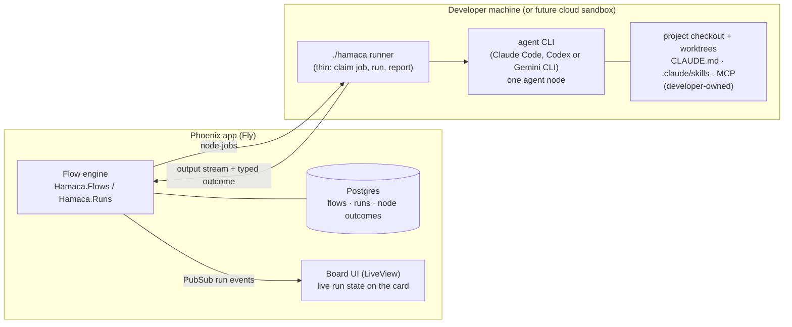
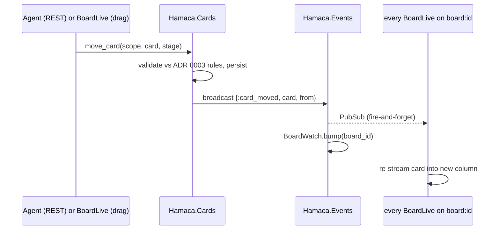
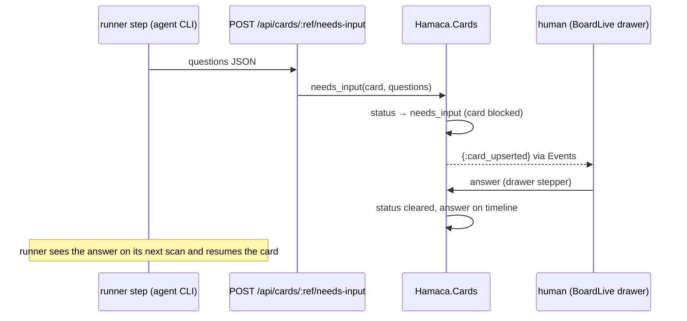

# Runtime: processes, topics, real-time flow

## Supervision tree



One flat `one_for_one` supervisor (`Hamaca.Supervisor`, started by `Hamaca.Application`):

| Child | Purpose |
| --- | --- |
| `HamacaWeb.Telemetry` | telemetry metrics/poller |
| `Hamaca.Repo` | Ecto → Postgres |
| `DNSCluster` | Fly multi-node discovery (no-op locally) |
| `Phoenix.PubSub` (`Hamaca.PubSub`) | all topics below |
| `Hamaca.Presence` | `Phoenix.Presence` tracker + fetcher `Task.Supervisor` for story-map presence (RE257); requires `Phoenix.PubSub` above, touches no database |
| `HamacaWeb.ApiLog` | in-memory recent API request log for the admin page |
| `Hamaca.BoardWatch` | ETS owner for per-board version counters (RLY-12) |
| `Registry` (`Hamaca.Runs.InstanceRegistry`) | engine-instance lookup keyed by owner pid (RE298 / ADR 0009); empty in production, where every resolution falls through to `Hamaca.Runs.Instance.default/0` |
| `Hamaca.Runs.Capacity` | ETS owner for per-runner advertised (configured, not live-free) slot counts (RLY-133), fed by the runner heartbeat; one row per runner tagged with its board id (`{runner_id, board_id, slots}`, RE402); `snapshot/0` still returns `%{runner_id => slots}` and each scheduler narrows it to its own board's runners (RE338); `live?/1` answers from ETS alone whether a board has any positive advertised slot; a stale runner's entry is evicted by the reaper's `reclaim_stale_runners/0` sweep at the stale threshold (`Hamaca.Runs.runner_stale?/2`) — before, and independently of, the later reclaim windows that requeue or park its jobs (RE449) |
| `Registry` (`Hamaca.Runs.SchedulerRegistry`) | per-board scheduler lookup keys (RLY-133) |
| `Hamaca.Runs.SchedulerSupervisor` | DynamicSupervisor for per-board `Scheduler.Server`s (RLY-133); `reconcile/1` starts one for every board that has none, at boot **and** on every `RunnerReaper` sweep, so a board created/unarchived after boot is adopted instead of silently never dispatching (RE387). Only when `:runs_auto_start`. Each `Scheduler.Server` catches and logs a raising reconcile and retries on its next event or tick, so one bad board can't crash-loop past this supervisor's restart intensity and take every board's scheduler down with it (RE387). A tick or capacity-changed wake-up on a board with no live capacity (`Hamaca.Runs.Capacity.live?/1`) and no active runs at its last full reconcile is skipped with zero queries (RE402); card events, `{:stages_changed, board_id}` (a board-shape change can pause or un-pause a flow, RE430), `reconcile_now/1` and the boot reconcile always reconcile in full. Ticks are jittered: the first lands in `[1, tick_ms]`, each later one in `tick_ms × [0.8, 1.2]` (`Scheduler.Server.tick_delay/2`), so boards' ~60s ticks don't fire in lockstep |
| `Hamaca.Activity.LogSink` | debounces runner log lines into one `insert_all` per burst (RLY-112) |
| `Hamaca.Activity.Pruner` | ages `:action` chatter out after 14 days; first sweep one interval after boot |
| `Hamaca.Usage.Tracker` | the only writer of `usage_visits` (RE475): keeps one open visit per signed-in user in memory, fed by `touch/3` casts from `HamacaWeb.UsageTrack` (LiveView hook) and `HamacaWeb.Plugs.UsageTrack` (`:browser` plug) — no DB per touch. Every `Hamaca.Usage.flush_ms/0` (60s) it upserts the dirty visits in one `insert_all` on `(user_id, started_at)`, and issues no query when nothing changed; it traps exits so a graceful shutdown flushes too. Best-effort like `LogSink`: a DB error drops the batch (one `warning`), a crash loses the in-memory visits — at most a minute of usage. Started only when `:usage_tracking` (default `true`, `false` in test, where each test starts its own and points `:usage_tracker` at it). One per node, never merged across nodes — prod runs one machine |
| `Hamaca.Billing.Clock` | the hourly billing clock (RE460): each tick takes the Postgres advisory lock `Clock.lock_key/0` inside `Repo.checkout/1` (one node runs it; `:skipped` elsewhere) and runs `Hamaca.Billing.run_clock(Date.utc_today(), final_pass?: hour >= Clock.final_pass_hour())` — resolving unknown/overdue-pending attempts with Stripe, then renewals and the grace day's one retry, then the once-only billing emails (card declined, dropped to Free). There is no launch backfill and no first charge after a trial (RE469, [ADR 0013](../adr/0013-the-free-plan.md)): a Free account is never charged by the clock — it pays by upgrading. The tick rescues; each account is isolated. First tick 5s after boot. Started `enabled: Hamaca.Billing.enabled?()` — with billing off (test, self-hosted) no tick is ever scheduled |
| `Task.Supervisor` (`Hamaca.Push.TaskSupervisor`) | push dispatch off the caller's process (RLY-81) |
| `Task.Supervisor` (`Hamaca.Billing.TaskSupervisor`) | billing-email delivery off the caller's process (`Hamaca.Billing.Notifier.dispatch/1`, RE464), so a mail-provider failure or stall never reaches the billing clock; inline in test |
| `Finch` (`Hamaca.Push.APNSFinch`) | dedicated HTTP/2 pool — APNs requires h2; Req's default pool is h1-first |
| `Hamaca.Runs.Supervisor` | runs engine (RLY-132): run-id `Registry`, `DynamicSupervisor` with one transient `RunServer` per `:running` run, the card-event `Listener` (which self-heals via its own `{:continue, :boot_reconcile}` sweep over every `:parked` run at startup — RLY-200), a boot task that resumes unfinished runs from Postgres — boot resume attaches to every `:running` run that still has an active (`queued`/`claimed`) job, so no revoke and no re-dispatch, and re-enters only a run with no active job (`Hamaca.Runs.boot_mode/1`, RE410) or with an open fan-out region, whose re-entry leaves every branch that kept its job alone (RE437); staleness is left to the `RunnerReaper` and orphan requeue, and `Hamaca.Runs.RunnerReaper` (RLY-134, inside this `rest_for_one` subtree). `RunServer.init/1` returns `:ignore` for a run that is not `:running` — except `:attach` on a run parked while a fan-out sibling branch still runs, which stops after each report (RE437) — and a run whose server cannot start is failed via `abandon_serverless_run/2` (boot resume included) rather than left orphaned (RE412, failures.md A13). Not started in test. |
| `Hamaca.Runs.RunnerReaper` | inside `Hamaca.Runs.Supervisor` — periodic (30s) run-lifecycle sweeps (runner liveness + orphaned-run closure + unresumable-run ageing + scheduler presence): `Hamaca.Runs.reclaim_stale_runners/0` applies three liveness windows (RE449): past the stale threshold (`Hamaca.Runs.runner_stale?/2`, `max(60s, 2 × interval)`) a runner stops counting — its `Hamaca.Runs.Capacity` entry is cleared (RE402) — but no job is touched; its `shared_clean` jobs are requeued unpinned only once silent past `Hamaca.Runs.shared_reclaim_after_s/0` (3 min) and its `exclusive` runs parked (`parked_reason: :runner_gone`) only past `Hamaca.Runs.exclusive_reclaim_after_s/0` (10 min), each window floored at the stale threshold — so a runner back from a blip reattaches to its still-`:claimed` jobs for free; `Hamaca.Runs.close_orphaned_runs/0` closes any run still active while its card is already in a terminal-type stage (RLY-233) or archived (RE335); `Hamaca.Runs.abandon_unresumable_runs/0` fails a parked run whose resume the scheduler has refused continuously for `Hamaca.Runs.unresumable_after_s/0` (30 min), so a dead end becomes a visible failure a human can `retry` (RE297); and `Hamaca.Runs.SchedulerSupervisor.reconcile/0` (last in the sweep) adopts any board lacking a scheduler (RE387). No new PubSub topic — the claim long-poll (`POST /api/node-jobs/claim`) reuses `board:<id>:runs` below. |
| `HamacaWeb.Endpoint` | Bandit HTTP server, WebSockets |

## Hosts

`PHX_HOST` is the canonical host (`hamaca.app` in `fly.toml`): `HamacaWeb.Endpoint.url/0`, and so
every absolute URL the app generates (install scripts, mail links, the runner's board URL), uses
it. `PHX_EXTRA_HOSTS` (comma-separated; `relayboard.fly.dev,www.hamaca.app` in prod) names the
other hostnames that serve the same app. `config/runtime.exs` parses it once — trimmed,
downcased, blanks dropped — into `:hamaca, :extra_hosts` (default `[]` in `config/config.exs`;
never set from the environment in `:test`), and both consumers read that one list:

- the prod endpoint's `check_origin` accepts `//<host>` for `PHX_HOST` and every extra host, so
  a tab still open on an old host keeps its LiveView socket;
- `HamacaWeb.Plugs.CanonicalHost` (RE480), the **first** plug in the router's `:browser`
  pipeline (before `:fetch_session`, so a redirect never sets a cookie on the old host), answers
  a `GET` on an extra host with `301` to `HamacaWeb.Endpoint.url/0` plus the same path and query.

What never redirects, and why:

| Request | Why it answers in place |
| --- | --- |
| `/api/*`, `/api/auth/native/*` | runners, `.envrc` `RELAY_URL`s and old app builds point at the old host; not in `:browser` |
| `/b/:slug/install` | install scripts are piped into `sh` (pipeline-free route) |
| `/webhooks/*` | Stripe posts to the URL it was configured with (`:webhook` pipeline) |
| `/auth/*` | an OAuth flow in flight must finish on the host it started on (plug's `@pass_through`) |
| `/attachments/*` | links embedded in card markdown keep loading (plug's `@pass_through`) |
| the native app's webview | old app builds load LiveViews from the host they signed in on, where their session cookie lives; `HamacaWeb.Plugs.Embed.embedded?/1` (`?embed=1`, the `relay_embed` cookie, or an embedded session) |
| non-`GET` | a 301 turns a POST into a GET and drops its body (`HEAD` is already `GET` via `Plug.Head`) |
| `/live`, `/live/longpoll` | the socket never passes the router — open tabs keep their connection |

Sessions are per host (the `_relay_key` cookie belongs to the host that set it), so a user
signed in on `relayboard.fly.dev` signs in once more on `hamaca.app`. The 301 is intentionally
permanent.

## Stripe webhook (RE460)

`POST /webhooks/stripe` → `HamacaWeb.StripeWebhookController.create/2`, in the `:webhook`
pipeline (accepts JSON; no session, no CSRF — the signature is the authentication).
`HamacaWeb.RawBodyReader`, the endpoint's `Plug.Parsers` `body_reader`, keeps the raw body in
`conn.private[:raw_body]` for this path only. `Hamaca.Billing.verify_webhook/2` checks the
`Stripe-Signature` (`t=…,v1=…`, HMAC-SHA256 of `"<t>.<body>"` under `:stripe_webhook_secret`,
±`Hamaca.Billing.Webhook.tolerance_s/0` = 300s) — a failure is 400 `invalid_signature`. A verified
event is acknowledged 200 `{"ok":true}` whatever it is; a setup-mode `checkout.session.completed`
or a `setup_intent.succeeded` saves the card (`Hamaca.Billing.complete_setup/3`, the same call the
Billing page's return URL makes — safe to run twice). 404 while billing is disabled. In dev/test
(`:dev_routes`) `GET /dev/billing-checkout` is the Local payments' stand-in for Stripe Checkout:
two links back to same-origin `succeed` / `decline` paths (anything else is 400).
`GET /dev/mailbox` (`Plug.Swoosh.MailboxPreview`, also `:dev_routes` only) lists the billing
emails (RE464) delivered to Swoosh's Local adapter in dev.

## Session lifetime

The browser session is a signed cookie (`_hamaca_key`, no server-side record). Its policy is
**7 days, sliding** (RLY-127), and it lives in three places that must agree:

| Piece | Where | Role |
| --- | --- | --- |
| `HamacaWeb.SessionPolicy` | `lib/hamaca_web/session_policy.ex` | the only copy of the numbers: `max_age/0` = 7 days, `refresh_after/0` = 1 day |
| `max_age` on `@session_options` | `lib/hamaca_web/endpoint.ex` | makes `_hamaca_key` persistent so it survives tab eviction / browser restart. Also reaches the LiveView socket via `connect_info` |
| `:session_refreshed_at` in the session | `HamacaWeb.Auth` | the server-side window |

The cookie attribute is a **client-side hint only** — `Plug.Session.COOKIE.get/3` does no age
check, so a client can replay an arbitrarily old cookie. `HamacaWeb.Auth` therefore enforces the
window itself:

- `fetch_current_scope/2` (the `:browser` and `:native_user_auth` pipelines) **expires** a session stamped past
  `max_age/0` and **re-stamps** one older than `refresh_after/0`. The re-stamp is a session
  write, and `Plug.Session` only emits `Set-Cookie` on a write — that is what slides the
  cookie's `Max-Age` forward. Throttling to once a day is what keeps `Set-Cookie` off every
  response.
- `mount_current_scope/2` (the `on_mount` hooks) **expires only** — a LiveView mount has no
  `conn` and cannot write a cookie. It closes the hole where a stale cookie mounts a LiveView
  on socket reconnect without passing through the plug pipeline.
- `NativeAuthController.me/2` **expires and re-stamps**: it rejects a session past the window
  with 401 and mints no bearer token — `me/2` is the only server-side check a replayed native
  cookie ever meets (the `:native_auth` pipeline does not run `fetch_current_scope/2`), and
  `mint_token/1` hands back a bearer that outlives the session it came from. On success it
  re-stamps: the Flutter shell's launch-time verify is the native app's only touch point, and
  `_restore()` writes the refreshed cookie back to the Keychain.
- A session with **no** stamp (predating RLY-127) is re-stamped, never expired — expiring them
  would sign out every existing user on deploy.

There is no revocation: invalidating a session today means rotating `SECRET_KEY_BASE`, which
signs out everyone everywhere. Server-side session records and "sign out of all devices" are
tracked as a separate follow-up.

### On-device state (mobile app)

The Flutter app keeps three Keychain items (`flutter_secure_storage`, `first_unlock`), each
behind a store interface with an in-memory test double:

| Item | Key | Store | Holds |
| --- | --- | --- | --- |
| Session cookie | `relay_session_cookie` | `SessionStore` | the `_hamaca_key` cookie the launch-time `/me` verify restores and slides |
| Last board | `relay_last_board_slug` | `BoardPrefs` | the current board's slug (RLY-95 / RE376) |
| Last place | `relay_last_place` | `LastPlaceStore` | one JSON place (RE452): the tab, the Board tab's stage page, and a card opened from the Board tab (`back=Board`) — written by `LastPlaceTracker` from the router delegate, read once at launch through `LastPlaceController.takeLaunchPlace/0` |

All three are cleared on sign-out and on a dead session (`AuthController._clearSession`).
Switching to a different board, or clearing it, forgets the last place's stage and card but
keeps its tab.

On a cold launch the router's redirect holds the splash until the board and the last place are
read, then reopens the place through `LaunchRestorer` (`flutter/lib/app/launch_restorer.dart`); a
pending push tap wins, and an interactive sign-in still primes push permission. A remembered card
is checked with `GET /api/all/cards/:ref?board=<slug>` (3 s bound). If it's live, it reopens silently
over its current stage. If it was archived, the board opens on the card's stage with the toast
`<REF> was archived`; a 404 opens the remembered stage with `<REF> was deleted`. On a timeout or
any other failure, the card opens unverified. A restored stage the board no longer has
(`relayStageMissing`) toasts `The <Stage> stage no longer exists`, once, and never after a card
toast. A restored card puts the board webview *under* the pushed card, where the pager's one-shot
`?stage=` scroll runs with no real layout and drifts. So `BoardScreen` drops `relayStageChanged`
while a pushed route covers the board, and when the board is revealed it asks the pager to re-show
the last page seen on screen (else the requested stage) with the `relay:show-stage` window event.

## PubSub topics

| Topic | Broadcaster | Events | Subscribers |
| --- | --- | --- | --- |
| `board:<board_id>` | `Hamaca.Events` — contexts only, after successful mutations, delivered after the outermost transaction commits (dropped on rollback) | `{:card_upserted, card}`, `{:card_moved, card, from_stage_id}`, `{:card_archived, card}`, `{:timeline_appended, card_id, entry}`, `{:card_log_appended, card_id, entries}`, `{:stages_changed, board_id}`, `{:story_map_changed, board_id}`, `{:board_updated, board}`, `{:vote_changed, card_id}`, `{:setup_changed, board_id}` | every open `BoardLive` for that board (and, for `{:vote_changed, card_id}`, the public board — same fire-and-forget contract); `{:setup_changed, board_id}` (`Hamaca.Setup`, RE443; since RE446 also sent when a runner heartbeat ticks setup step 6 or a node-job claim ticks step 7, both observed after the request's own writes, by `Setup.close/1` / `reopen/1`, and for every change to a connected machine's checklist — `connect_machine/2`, its reports, its heartbeat — on its board's topic) reaches every open `BoardLive`, which re-reads only `Setup.checklist/1` so the setup wizard re-renders live (the shown-once step-3 key stays in that socket's assigns only while step 3 is current or its peek is open); every open `HamacaWeb.ValueStreamLive` (RE347) recomputes on `{:card_moved, …}`, `{:card_archived, …}`, `{:stages_changed, …}` and an `:approved` / `:rejected` `{:timeline_appended, …}`; every per-board `Hamaca.Runs.Scheduler.Server` reconciles (debounced, in full) on `{:card_moved, …}`, `{:card_upserted, …}`, `{:card_archived, …}` and `{:stages_changed, …}` — the last re-checks the board shape, so fixing it un-pauses a paused flow (RE430) |
| `board:<board_id>:logs` | `Hamaca.AgentLog` | `{:agent_log, entry}` — live runner feed lines | the board's log sheet, only while open (no backfill by design) |
| `board:<board_id>:runs` | `Hamaca.Runs` — delivered after the outermost transaction commits (dropped on rollback) | `{:run_started, run}`, `{:node_started, run, execution}`, `{:node_finished, run, execution}`, `{:run_parked, run}`, `{:run_resumed, run}`, `{:run_finished, run}`, `{:run_changed, card_id}` | run UI (card 07/W8) and tests. Does NOT bump `BoardWatch`. The engine's fine-grained events above are internal; `{:run_changed, card_id}` (`Hamaca.Runs.broadcast_run_changed/2`, RLY-137) is the read side's coarse public contract — a subscriber refetches the card's runs/summary rather than patching state from a payload. `HamacaWeb.ValueStreamFlowLive` (RE349) recomputes on `{:run_changed, card_id}`. A runner claiming a **flow** job (`Hamaca.Runs.claim_next_job/4`, after the claim commits) also emits `{:run_changed, card_id}` (RE358 — a Steer now restart's "Stopping…" ends and its receipt lands at the claim); claiming a talk job does not. |
| `story_map_presence:<board_id>` | `Hamaca.Presence` (Phoenix.Presence's diff protocol) | `%Phoenix.Socket.Broadcast{event: "presence_diff"}` — joins/leaves of story-map viewers | every open `BoardLive` with `live_action == :story_map`. Does NOT bump `BoardWatch` |
| `story_map_cursor:<board_id>` | `Hamaca.Presence` | `{:story_map_cursor, user_id, name, email, x, y}`, `{:story_map_cursor_gone, user_id}` | the same sockets; each relays to its own client with `push_event/3` (no template diff). Does NOT bump `BoardWatch` |
| `story_map_view:<board_id>` | `Hamaca.StoryMap.merge_view/2` (which `put_view/3`, `toggle_view/2` and `toggle_view_member/4` all compose) | `{:story_map_view_changed, board_id, view}` — the board-wide shared map view settings changed | the same sockets, **including the writer** (there is no optimistic local assign). Does NOT bump `BoardWatch` |
| `events:firehose` | `Hamaca.Events` — mirrors every board event as `{board_id, event}` | every `board:<board_id>` event, tagged with its board id | `Hamaca.Runs.Listener` (reconciles card events against runs — RLY-132; its first rule closes, rather than resumes, an active run whose card has reached a terminal-type stage or been archived — RLY-233, RE335; `{:card_archived, card}` triggers a reconcile) |
| `runs:capacity` | `Hamaca.Runs.Capacity` | `{:runner_capacity_changed, runner_id}` — broadcast only when a runner's entry actually changes (slots or board id) or is removed; a heartbeat re-advertising the same total is silent (RE402) | every per-board `Hamaca.Runs.Scheduler.Server` |
| `api_log` | `HamacaWeb.ApiLog` | `{:api_log, entry}` | `Admin.ApiLive` |
| `card:<card_id>:talk` | `Hamaca.Talk` (RE268 / ADR 0014) | `{:talk_event, event}`, `{:talk_turn_changed, turn}` | the open `BoardLive` whose drawer is on the Talk tab, only while it is |
| `billing:<user_id>` | `Hamaca.Billing` (RE460) — `broadcast_changed/1`, when a plan is cancelled or resumed, the owner picks which board stays editable on Free (`choose_free_board/2`, RE471), a card is saved, a promo code is redeemed, a payment attempt opens or settles (`Hamaca.Billing.Charging`, after each commit), or the superadmin comps / un-comps, holds / lifts a hold, extends or retries the charge from the `/admin/users` side panel (`Hamaca.Billing.Admin`, RE463, after commit); RE469 — and from the web layer when an owner archives a board (`BoardSettingsLive`) or restores one (`BoardLive`), since either moves them against the Free limit | `{:billing_changed, user_id}` — the user's billing standing may have changed; carries no state | `BoardLive` (subscribed to the board owner's topic), `BillingLive` and `BoardsLive` (RE469, the viewer's own topic: plan line, READ-ONLY tiles, picker footer), which re-read `Hamaca.Billing` standing. Does NOT bump `BoardWatch` |
| `user:<user_id>:notify` | `Hamaca.Push` (RE399) — fire-and-forget, after commit (dropped on rollback); the same `dispatch/2` path as APNs, to every push recipient whether or not they have a device token — a member who muted the board (RE406, `board_members.muted`) still receives this broadcast; only their APNs push is skipped | `{:browser_notification, message}` — `message` = `%{id, kind, title, body, card_ref, board_slug, board_name, card_title}` (`Hamaca.Push.message/2`; `id` is shared by every recipient of one event) | every non-embed authenticated LiveView via `HamacaWeb.BrowserNotify`, which relays it to the client as `push_event "relay:notify"` only from a LiveView showing `message.board_slug` (its `:board` assign — the board or any `/board/:slug/…` sub-page, read at delivery; RE404); other LiveViews (another board, `/boards`, `/admin`) drop it. Does NOT bump `BoardWatch` |

Three invariants make the seam trustworthy: **only contexts broadcast** domain events (so
LiveView and REST mutations share one path), broadcasting is **fire-and-forget** (a
PubSub failure can never fail the mutation), and events are **delivered after commit**: an
event broadcast inside a transaction is queued and sent once the outermost `Hamaca.Repo`
transaction commits, and discarded on rollback (`Hamaca.Repo.after_commit/1`, RE386). The
same holds for `Hamaca.Runs`' `board:<board_id>:runs` events. Every `Events.broadcast/2` also bumps the
board's `BoardWatch` version, which the CLI polls to avoid refetching unchanged boards.

RE257's three topics are the deliberate exception to "only contexts broadcast domain events":
they carry **presence**, not mutations, and they bypass `Hamaca.Events` precisely so they never
bump the board version — a cursor at 20 Hz through `Events.broadcast/2` would be a write storm
against the CLI's version poll.

## Load-bearing sequences

A card move fanning out to every open board (same path for REST and LiveView writers):



The needs-input round trip (the baton passing to a human and back):



A terminally failed run takes a different path — `card_fail_effects/2` →
`Hamaca.Cards.mark_failed/3` → card status `:failed`, no question. `ensure_card_blocked/2` is
reserved for the genuine question above; the two never overlap (RLY-179).

### Fan-out regions (RE437)

A `fan_out` / `fan_in` pair is the one place a run holds several node jobs at once. Both are
**control nodes** (`Schemas.Flow.Node.control_types/0`): the run's `RunServer` resolves them
itself, writing a `node_executions` row with an immediate outcome and no `node_job`, so no
runner ever sees one. The region in between is tracked in `run_branches` (`Schemas.RunBranch`,
owned by `Hamaca.Runs`): one row per branch per **region entry**, keyed by the `fan_out`
execution that opened it, its `state` drawn from `Schemas.RunBranch.states/0` (the generated
table in [`state.md`](state.md)). Branch executions carry `node_executions.run_branch_id`.

```mermaid
sequenceDiagram
    participant S as RunServer (one per run)
    participant DB as runs · run_branches · node_jobs
    participant R as the run's runner (one worktree)
    S->>DB: record fan_out :succeeded (no job), one run_branches row per edge (queued)
    S->>DB: start up to max_parallel rows → running, enqueue each head node (run_branch_id set)
    DB-->>R: several node jobs of ONE run, claimed into the same checkout
    R->>S: report (per job)
    S->>S: Engine.decide/4 on that branch's history only
    alt branch reached the fan_in
        S->>DB: row → ended (outcome, detail); start the next queued row
    else branch parks on a human
        S->>DB: row → parked, run parked — siblings keep running
    end
    S->>DB: every row ended → record fan_in with Engine.join/1, route it like any node
```

- **Scheduling.** At most the `fan_out`'s `max_parallel` rows are `running`; each ended row frees
  a slot for the next `queued` one, by position. `run.current_node` stays the `fan_out` key while
  the region is open, and `Runs.active_jobs/1` returns one job per running branch.
- **Branch-scoped budgets.** `max_retries`, `max_loops`, the visit cap and the failure-signature
  breaker are counted on the branch's own history, so one branch's failures never spend
  another's. A branch's `{:fail, _}` ends only its row `:failed`; the run carries on to the join.
- **The join.** When every row is `ended`, the `fan_in` resolves through
  `Hamaca.Runs.Engine.join/1` — wait-all, any-failed — which owns the outcome rule and the
  per-branch label format (don't re-derive either).
- **Park with siblings.** A branch that waits on a human parks its row and the run, but revokes
  no sibling job. While the run is parked, a report from a `running` branch is still accepted
  (`Runs.report_accepted?/2`) and routed inside that branch; `RunServer` attaches for it only
  when `Runs.attachable_while_parked?/1` says so and stops again after each report, so a parked
  run holds no long-lived process. No queued branch starts and no join happens until resume.
- **Re-entry and restart.** Every re-entry with a region open (`Runs.open_region/1`) — resume,
  `--at`, a restart after a deploy (`Runs.boot_mode/1` always re-enters such a run) — goes branch
  by branch: a running row with a live job is left alone; one without, and every parked row, gets
  a fresh attempt of the same visit. Re-entering at a branch node or a `fan_in` with no region open
  opens a fresh region at its `fan_out` (`Runs.retry_run/2` maps the target the same way).
- **Cancel and close.** `cancel_run/2` and `close_run!/3` end every open row
  (`Runs.end_open_branches!/1`), so a terminal run never leaves a branch `queued` or `running`.

The card drawer timeline groups each region entry (RE440). `Hamaca.Runs.RunDetail` reads the
`run_branches` that `Runs.list_runs_for_card/1` preloads and turns each `fan_out` execution that
opened an entry into one `:region` row: the `fan_out` as its header, a tally
(`RunDetail.branch_tally/1`), and one lane per branch in `position` order — never start order —
with loop rows computed within the lane. A branch held back by `max_parallel` shows a `:queued`
placeholder; an in-flight branch node stays active even while a sibling parks the run. An open
region is followed by a synthetic `:waiting` `fan_in` row; a joined one annotates the real
`fan_in` with `join` (total / failed) and the row after it with `joined_from`. A region entered
twice renders twice, one group per `fan_out` execution. `RunDetail.branch_bars` gives each
`fan_out` key its latest entry's per-branch bars (`RunDetail.branch_bar/1`, closed set
`bar_states/0`), and the card-face summary carries `branches` — the open entry's tally plus its
bars, nil once it joins (`Runs.open_region/1`'s rule, read for the whole board in one query).
`Runs.happy_path/1` still steps from the `fan_out` straight to its `fan_in`, so a card face
reads "node N of M" against the `fan_out` while the region is open. The full engine rules are in
[runner.md](runner.md#fan-out-regions-re437); the runner side — concurrent node jobs in one
worktree — is in [runner.md's worktree pool](runner.md#runner-mode-hamaca-start-rly-135).

---
*Sources of truth: `lib/hamaca/application.ex`, `lib/hamaca/events.ex`,
`lib/hamaca/agent_log.ex`, `lib/hamaca/board_watch.ex`,
`lib/hamaca_web/api_log.ex`, `lib/hamaca/runs.ex`, `lib/hamaca/runs/supervisor.ex`,
`lib/hamaca/runs/listener.ex`, `lib/hamaca/runs/runner_reaper.ex`, `lib/hamaca/runs/`,
`lib/hamaca/talk.ex`.*
