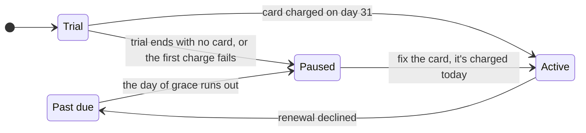

# Billing & self-hosting

Relay is **open source**, and you can run it yourself for free. **Relay Cloud** is the same
Relay, run by us, for **$20/month**. This page explains how the two differ and how paying
for Relay Cloud works: the trial, renewals, a failed card, pausing, cancelling and promo codes.

## Self-host or Relay Cloud

It's **the same software** either way. Relay is open source under the **MIT license**. Every
feature is in it, and there is no "enterprise edition".

- **Self-hosting is free forever.** When you run Relay yourself, you take on the upkeep:
  **upgrades**, **backups** and **push certificates**.
- **The name is protected.** You can fork Relay, but a fork can't be called "Relay". Forks
  must rename.
- **A self-hosted Relay never charges anyone.** Billing is off unless `BILLING_ENABLED` and
  the Stripe keys are set.

**Relay Cloud** is for when you'd rather we ran it. The $20/month pays for us to host it, and
everything below is about Relay Cloud.

## Your trial

Relay Cloud starts with **30 days free**, and you don't need a card to start. We ask for a
card during the trial. If the trial ends with no card, the account is **paused** (see
[Paused means read-only](#paused-means-read-only)).

## Paying

- **You pay up front.** A payment buys the next month, starting the day you pay. Your billing
  date is your own.
- **It's $20/month**, and that covers every board you own.
- **The board owner pays.** Invited members are free and never see billing.
- **No invoices, no debt and no proration.**
- **Monthly only**, for now.

## How an account moves

## If a card fails

When a renewal is declined, you get **one day past due**:

- a banner on your boards,
- a "card declined" email,
- and one retry at the end of that day.

If that retry fails too, the account is paused.

## Paused means read-only

A paused account is **read-only**. **Nothing is deleted.**

- You can still see your boards.
- Cards don't open, and settings are off.
- `./relay` and runners get `402 plan_paused`.

When the owner is paused, their boards are read-only **for every member**.

To unpause, pay. Paying starts a fresh month that day, and nothing is back-billed.

## Cancelling

When you cancel, you keep access through the date you've paid up to. There are **no refunds**.

## Promo codes

A promo code gives **X months at Y% off**, starting after the trial. There's **one code per
account**. You can add it when you sign up, or later in **Billing**.

For example, `RELAYCONF` is 3 months at 50% off: $10 × 3, then $20.

## On iOS

The app shows your plan's status only. **You pay on the web.**
